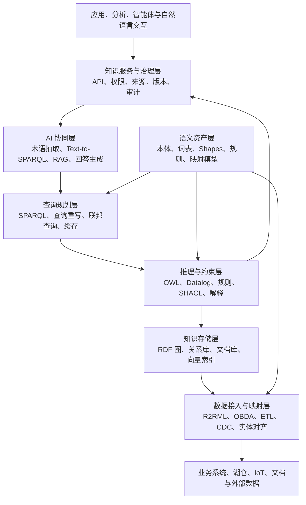

# 本体论知识引擎：架构、推理与工程实践

> 本文所说的“本体论知识引擎”，是信息技术语境中的**本体驱动知识引擎**（ontology-driven knowledge engine），不是对哲学本体论的讨论。它以形式化本体为语义契约，把事实、数据映射、逻辑推理、约束校验、查询、解释和治理组织成可运行的知识系统。

> 调研与文献核验日期：2026 年 10 月 30 日

## 摘要

企业并不缺少数据，真正稀缺的是跨系统可共享、可计算、可解释的业务含义。数据库保存表和字段，知识图谱连接实体与关系，大语言模型处理自然语言，但仅凭其中任何一种技术，都难以稳定回答“某个结论为什么成立”“多个系统里的对象是否表达同一事物”“一项业务判断依据了哪些规则和事实”等问题。

本体驱动知识引擎以本体定义概念、关系和公理，以知识图谱或原有数据库承载事实，通过映射接入多源数据，以 OWL 推理、规则计算和 SHACL 校验处理不同类型的语义任务，再通过 SPARQL、API 和自然语言接口向应用提供知识服务。它不是单一数据库、推理器或问答机器人，而是一套从语义建模到生产运行的系统能力。

本文首先澄清本体、知识图谱、规则引擎、搜索引擎、RAG 与知识引擎的边界，然后以设备故障诊断与维修为贯穿案例，说明知识引擎的总体架构、可计算语义、推理机制、数据接入、查询规划、解释、LLM 协同、工程治理和实施路线。文章最后给出技术选型矩阵、评价指标、常见失败模式及相关论文与标准。

## 一、为什么企业需要本体驱动知识引擎

### 1.1 数据可访问，不等于知识可计算

假设一家制造企业已经建设了设备台账、物联网平台、告警系统、工单系统和人员系统。用户提出以下问题：

- 哪些关键设备在过去 24 小时内出现过高风险告警？
- 某次故障涉及什么部件，依据哪些观测得出诊断？
- 同类故障采用过哪些维修动作，结果如何？
- 哪些工单缺少合格执行人或必要的关闭证据？
- 为什么系统把 `P-101` 判定为关键泵？

这些问题往往需要跨越多个数据库和文档。仅做表连接会遇到名称、标识、粒度和口径不一致；仅做全文检索可以找到相关材料，却不能保证概念和关系的含义一致；仅让大语言模型直接回答，则难以保证结论严格来自受控数据与规则。

本体工程的核心价值，是为领域建立明确的概念化及其形式化规范。Gruber 将本体概括为“概念化的显式规约”，Studer 等人进一步强调它是“共享概念化的形式化、显式规约”[1][2]。这里的“共享”意味着术语不是个人约定，“形式化”意味着机器能够处理，“显式”意味着关键语义不能只存在于专家经验中。

### 1.2 从“统一词汇”走向“运行时语义”

词汇表只能说明术语名称和释义。知识引擎还需要把语义带入运行过程：

1. **识别对象**：不同系统中的设备编码能否归并到同一业务对象。
2. **解释关系**：`hasComponent`、`affectedBy`、`performedBy` 分别表示什么，其定义域和值域是什么。
3. **执行推理**：根据类层次、属性限制和规则推出未显式存储的结论。
4. **验证数据**：检查工单是否缺少关闭时间、故障是否缺少关联设备。
5. **回答查询**：把业务问题转换为图查询、SQL 或混合检索计划。
6. **给出依据**：区分源数据、推导事实、模型规则和生成式回答。
7. **治理演进**：在本体、映射和规则变更时控制影响范围并支持回归测试。

因此，知识引擎不是“把数据变成三元组”就结束，而是让统一语义进入查询、判断、解释和应用集成的全过程。

## 二、“本体论知识引擎”到底是什么

本文采用如下工程定义：

> **本体驱动知识引擎，是以形式化本体为语义契约，连接事实数据、数据映射、逻辑推理、规则与约束、查询规划、证据解释和生命周期治理，并向人、应用与智能体提供可计算知识服务的运行系统。**

可以把一个知识引擎抽象为：

```text
KE = <O, F, M, R, C, Q, P, G>
```

其中：

| 符号 | 含义 | 典型内容 |
| --- | --- | --- |
| `O` | Ontology，本体 | 类、属性、公理、命名空间、模块 |
| `F` | Facts，事实 | RDF 三元组、事件、主数据、文档证据 |
| `M` | Mappings，映射 | R2RML、OBDA 映射、ETL、API 适配 |
| `R` | Reasoning/Rules，推理与规则 | OWL 推理、Datalog、业务规则、决策表 |
| `C` | Constraints，约束 | SHACL Shapes、数据质量规则、接口契约 |
| `Q` | Query，查询 | SPARQL、查询重写、图查询、SQL、检索 |
| `P` | Provenance，来源与证明 | 来源、时间、版本、推理依赖、解释链 |
| `G` | Governance，治理 | 权限、版本、发布、监控、测试和审计 |

这一定义有两个重要含义。

第一，本体是引擎的语义核心，但不是整个引擎。只保存一份 OWL 文件，尚未形成可运行的知识服务。第二，知识引擎可以采用不同物理实现：事实可以全部物化到 RDF 图，也可以通过 OBDA 留在关系数据库，还可以根据数据特征采用混合架构。

## 三、与相邻技术的边界

### 3.1 本体与知识图谱

知识图谱通常以节点和边组织事实，本体则规定这些节点和边的类别、含义以及可以进行何种逻辑推导。Hogan 等人的综述把知识图谱的表示、获取、查询、推理和质量等问题放在统一框架中讨论[5]；Ji 等人则系统总结了知识图谱表示学习、获取和应用路线[6]。

二者不是替代关系：

- 知识图谱回答“目前记录了哪些对象和关系”；
- 本体回答“这些对象和关系是什么意思，以及什么结论可由它们蕴含”；
- 知识引擎负责让模型和事实共同参与运行。

没有本体的图仍然可以遍历、统计和做图算法，但边的含义可能只依赖应用代码。没有实例数据的本体可以表达领域理论，但无法回答具体业务对象的问题。

### 3.2 逻辑推理与图遍历

图遍历回答路径是否存在，例如从设备沿 `hasComponent` 找到部件，再沿 `involvedIn` 找到故障事件。本体推理回答结论是否被知识库蕴含。设知识库为 `K`、结论为 `α`：

```text
K ⊨ α
```

表示 `K` 的每个模型都满足 `α`。这与“图中碰巧有一条路径”不是同一个正确性标准。图遍历可以是推理实现中的执行手段，但普通遍历不会自动处理类等价、存在限制、属性链、互斥、公理一致性等形式语义。OWL 的描述逻辑基础及其与 RDF 的关系，可参见 Horrocks 等人的工作[7]。

### 3.3 OWL 推理与 SHACL 校验

OWL 采用开放世界假设：知识库没有记录某个事实，通常不代表该事实为假。例如没有记录泵的安装位置，不能直接推出“该泵没有安装位置”。OWL 还默认不采用唯一名称假设：两个不同 IRI 不必然表示两个不同对象。

SHACL 主要用于检查给定数据图是否满足形状约束[22]。业务可以规定“每张关闭工单必须恰有一个关闭时间”，数据缺失时产生校验结果。这个任务不能简单等同于 OWL 下的一致性检查。

| 需求 | 更适合的机制 |
| --- | --- |
| `Pump` 是 `Equipment` 的子类 | OWL |
| 满足某些条件的泵可推断为关键泵 | OWL 或受控规则 |
| 关闭工单必须填写关闭时间 | SHACL |
| 高风险告警触发派单流程 | 规则引擎或流程引擎 |
| 风险评分超过阈值后选择处置等级 | 决策表或业务规则 |

### 3.4 搜索引擎、向量检索与 RAG

搜索和向量检索擅长从文本中召回相关内容，RAG 把召回内容提供给生成模型。它们解决的是相关性和上下文供给问题，并不天然提供形式逻辑的蕴含保证。

本体知识引擎可以为 RAG 提供术语归一、实体消歧、关系扩展、权限过滤和证据组织；RAG 则可以处理知识引擎未结构化的文档内容，以及把结构化结果转化为自然语言。两者应通过明确的证据边界组合，而不是把模型生成内容直接写成正式事实。

## 四、贯穿案例：设备故障诊断与维修

### 4.1 最小本体

设企业定义以下类和关系：

```text
Pump ⊑ Equipment
CriticalPump ≡ Pump ⊓ ∃hasComponent.CriticalComponent

Pump(P-101)
hasComponent(P-101, Bearing-7)
CriticalComponent(Bearing-7)
```

根据这些公理，可以推出：

```text
CriticalPump(P-101)
Equipment(P-101)
```

结论不是因为系统写死了 `P-101` 的标签，而是由“泵”“具有关键部件”和等价类定义共同蕴含。

### 4.2 从静态资产扩展到事件和证据

真实运维场景还需要表达：

- `FailureEvent`：一次具体故障事件；
- `Observation`：传感器读数、巡检记录或人工观察；
- `Diagnosis`：根据证据形成的诊断；
- `MaintenanceAction`：维修动作；
- `WorkOrder`：任务与流程载体；
- `Person` 与 `Qualification`：执行人员及资质；
- `Location` 与时间信息：事件发生和操作执行的上下文；
- `Evidence` 与 `SourceRecord`：结论所依据的来源。

典型事实可以写成：

```text
FailureEvent(F-2026-017)
affectsEquipment(F-2026-017, P-101)
supportedBy(Diagnosis-88, VibrationObservation-310)
diagnoses(Diagnosis-88, BearingWear)
resolvedBy(F-2026-017, Action-552)
performedBy(Action-552, Technician-42)
recordedIn(Action-552, WorkOrder-9001)
```

在此基础上，引擎可以支持四类任务：

1. 根据类公理和事实进行分类、实例判定与属性推断。
2. 根据 SHACL 检查工单、诊断和维修记录是否完整。
3. 联合图谱、数据库和文档回答跨域查询。
4. 为每个结论返回来源、规则、推理路径和版本信息。

### 4.3 用能力问题约束范围

第一版引擎不应追求“建完整个工厂”。应先定义可验收的能力问题（Competency Questions）：

| 编号 | 能力问题 | 需要的核心语义 |
| --- | --- | --- |
| CQ-01 | 哪些关键泵在 24 小时内发生过高风险故障？ | 设备分类、风险等级、事件时间 |
| CQ-02 | 某次诊断依据了哪些观测和规则？ | 诊断、证据、推理来源 |
| CQ-03 | 同类部件故障采用过哪些维修动作？ | 部件类型、故障类型、维修事件 |
| CQ-04 | 哪些关闭工单缺少关闭时间或执行人？ | 工单状态与 SHACL 约束 |
| CQ-05 | 为什么 `P-101` 属于关键泵？ | 最小或近似最小公理解释 |

能力问题同时约束本体范围、数据映射、查询接口和验收测试，防止模型变成无法验证的概念清单。

## 五、总体架构

一个企业级本体知识引擎可以划分为七层：



这是一种逻辑分层，不要求部署为七个独立产品。小型项目可以在同一进程中实现多个能力，大型项目则可能把本体注册中心、图数据库、OBDA 引擎、规则服务和生成式 AI 网关分开部署。

### 5.1 语义资产层

语义资产层保存可版本化的知识契约：

- 领域本体、上层本体和受控词表；
- SHACL Shapes；
- 数据映射和实体标识规则；
- 推理规则、决策表及适用范围；
- 能力问题、样例数据和预期结果；
- 模型来源、责任人、状态及发布记录。

本体、Shapes、映射和规则应分别管理，因为它们的语义和生命周期不同；但发布时需要通过兼容性检查形成可部署的版本组合。

### 5.2 数据接入与映射层

这一层把物理数据转换为本体中的对象和属性。映射至少要解决：

- 表、字段、接口和文档片段对应哪个概念；
- 业务主键如何构造稳定 IRI；
- 不同系统中的标识如何对齐；
- 单位、时间、代码表和空值如何转换；
- 数据变更如何增量传播；
- 来源、许可、敏感级别和有效时间如何保留。

映射不是一次性导入脚本，而是语义契约的一部分。字段或本体变更后，映射必须参与影响分析和回归测试。

### 5.3 知识存储层

知识存储层可以组合使用 RDF 三元组库、属性图、关系数据库、搜索索引、文档存储和向量数据库。存储技术的选择应由查询模式和一致性需求决定，而不是因为“知识”二字就强制把所有数据复制到图数据库。

### 5.4 推理与约束层

这一层执行分类、实例推断、一致性检查、规则计算、数据校验和证明记录。不同任务应调用不同的执行机制，并明确支持的逻辑子集、完备性和超时行为。

### 5.5 查询规划层

查询规划层接收结构化查询或自然语言转译结果，选择物化图、虚拟图、关系数据库、文档检索或混合路径。它还负责查询重写、权限下推、统计优化、结果合并和缓存。

### 5.6 AI 协同层

AI 协同层利用大语言模型处理非结构化材料和自然语言交互，但不绕过语义资产、权限和证据校验。模型输出默认是候选结果，正式知识必须经过验证和发布流程。

### 5.7 知识服务与治理层

最上层通过 API、事件和查询端点提供知识服务，同时记录谁在何时基于哪个模型版本查询或修改了什么。对高风险业务，服务返回值应包含结论状态、证据、来源时间、规则版本和不确定性说明。

## 六、本体如何形成可计算语义

RDF 1.1 规定了以三元组和图表示数据的基础模型[18]，OWL 2 则在此基础上提供面向本体的类、属性、公理与形式语义[19]。知识引擎必须区分“能够解析 RDF 图”和“能够按声明范围执行 OWL 推理”，二者不是同一能力。

### 6.1 TBox、ABox 与 RBox

描述逻辑通常把知识库区分为：

| 部分 | 作用 | 设备案例 |
| --- | --- | --- |
| TBox | 描述概念及概念间关系 | `Pump ⊑ Equipment` |
| ABox | 描述具体个体事实 | `Pump(P-101)` |
| RBox | 描述角色或属性公理 | `hasPart ∘ locatedAt ⊑ relatedLocation` |

这种划分有助于选择不同的推理和缓存策略，但工程中三者并非永远物理分离。某些查询需要联合 TBox 与大规模 ABox 处理。

### 6.2 IRI、类、属性与公理

每个正式概念应有稳定 IRI，而不应以展示名称作为身份。标签可以多语言变化，IRI 则承担跨系统引用。一个类的工程定义至少应记录：

- IRI、首选标签、定义和正反例；
- 上下位类、等价类与互斥类；
- 对象属性和数据属性；
- 定义域、值域及必要限制；
- 来源、负责人、版本和弃用状态。

公理让模型从分类目录变成可推理系统。例如：

```text
CriticalPump ≡ Pump ⊓ ∃hasComponent.CriticalComponent
```

这不是给 `CriticalPump` 增加一句自然语言说明，而是给出可由推理器执行的充分必要条件。

### 6.3 开放世界、非唯一名称与四值状态

由于开放世界假设，接口不宜只返回布尔值。对于一个待判断命题，更稳妥的状态是：

- `entailed`：知识库蕴含；
- `contradicted`：命题的逻辑否定被知识库蕴含；
- `unknown`：当前知识无法判定；
- `incomplete/timeout`：受能力边界或计算预算影响，未完成判定。

SHACL 违规应作为单独的 `validation result` 返回，不与逻辑反驳混为一谈。把 `unknown` 当成 `false`，会在数据不完整时产生错误业务结论；把超时伪装成“不成立”，则会掩盖系统能力问题。

### 6.4 OWL 2 Profiles 的工程选择

OWL 2 提供多个 Profiles，以限制表达能力换取特定计算性质[20]：

| 路线 | 适用重点 | 常见机制 | 主要代价 |
| --- | --- | --- | --- |
| OWL 2 DL | 复杂概念建模和精确一致性检查 | Tableau / Hypertableau | 最坏复杂度高，工程实现复杂 |
| OWL 2 EL | 大型术语体系和类层次分类 | 后果驱动的饱和计算 | 不支持任意否定、析取等构造 |
| OWL 2 QL | 大量事实保留在关系数据库 | 查询重写 | 表达力受限，重写结果可能膨胀 |
| OWL 2 RL | 规则化推导和图谱物化 | 前向链/Datalog | 物化规模和规则边界需控制 |

不存在适合所有业务的“最强模式”。系统应先根据能力问题确定必须支持的构造，再选择 Profile、推理器和数据架构。

## 七、知识引擎如何推理

### 7.1 核心推理任务

| 任务 | 要回答的问题 | 设备案例 |
| --- | --- | --- |
| 本体一致性 | 整体公理是否存在模型 | 关键泵是否同时被定义为设备和非设备 |
| 概念可满足性 | 某类是否可能有实例 | 某故障类型的条件是否互相矛盾 |
| 分类 | 类之间有哪些蕴含的上下位关系 | 推出 `CriticalPump ⊑ Equipment` |
| 实例检查 | 个体是否属于某类 | 判断 `CriticalPump(P-101)` |
| 实现/类型推断 | 个体最具体的类型是什么 | 得到关键泵、泵、设备 |
| 属性推断 | 哪些关系可以由公理推出 | 通过逆属性或属性链得到关联 |
| 解释 | 哪些公理和事实支持结论 | 返回关键部件及等价类定义 |

HermiT 是 OWL 2 推理器的代表性实现之一，采用 Hypertableau 等方法处理复杂本体[8]。工程项目通常应集成成熟推理器，而不是从完整 OWL 2 DL 开始自研。

### 7.2 四条执行路线

1. **描述逻辑推理**：适合复杂类表达式、可满足性和一致性判断。
2. **饱和分类**：面向 EL 等受限语言，高效计算大型术语层次。
3. **规则物化**：把可适用规则前向执行并保存推导事实，读取快但写入和撤回成本较高。
4. **查询重写**：把本体查询改写为可由数据库执行的查询，不预先生成全部推导事实。

实际系统可以混合使用。例如 TBox 用 EL 分类器预计算，稳定的 RL 规则做增量物化，大规模业务事实通过 QL/OBDA 查询重写访问。

### 7.3 增量推理与真值维护

生产数据持续变化。新增 `CriticalComponent(Bearing-7)` 后，引擎可以增量推出 `CriticalPump(P-101)`；删除该事实时，则必须判断这项结论是否还有其他证明路径。

因此，引擎需要记录推导依赖或证明摘要，支持：

- 根据新增事实只触发相关规则；
- 删除事实时撤回失去全部支持的推导；
- 在规则或本体版本变化后定位受影响结论；
- 区分显式事实、推导事实和临时查询结果。

### 7.4 解释不是附加日志

解释服务至少应能回答：

- 结论使用了哪些源事实；
- 应用了哪些公理或规则；
- 事实来自哪个系统、记录和时间；
- 结论由哪个引擎版本产生；
- 是否存在其他证明路径；
- 是否包含模型生成或人工确认环节。

对高风险结论，解释应作为接口契约的一部分，而不是事后从运行日志中猜测。

## 八、规则、约束与决策如何分工

### 8.1 四类机制的责任

| 机制 | 主要用途 | 语义特点 | 不宜承担的任务 |
| --- | --- | --- | --- |
| OWL | 概念定义、分类、蕴含、一致性 | 开放世界、单调逻辑 | 必填校验、带副作用流程 |
| SHACL | 数据形状和质量校验 | 针对给定数据图验证 | 替代完整 OWL 推理 |
| Datalog/规则 | 派生关系、复杂条件、部分闭世界规则 | 可控规则计算 | 无边界混入流程副作用 |
| 决策表/流程 | 阈值、优先级、动作和审批 | 面向业务决策与执行 | 定义领域概念的全部语义 |

### 8.2 同一案例中的组合

设备运维中可以这样分工：

```text
OWL：CriticalPump ≡ Pump ⊓ ∃hasComponent.CriticalComponent

SHACL：ClosedWorkOrder 必须有且仅有一个 closedAt，且至少有一个 performedBy

规则：高风险故障 + 关键设备 + 当前无有效工单 → 生成“需要派单”候选事件

决策表：根据风险等级、停机影响和人员可用性确定响应时限与审批级别
```

“生成候选事件”与“真正创建工单”也应分开。前者是知识计算结果，后者是有权限、事务和审计要求的业务操作。

## 九、多源数据如何进入引擎

### 9.1 RDF 物化

ETL 或流处理程序把源数据转换为 RDF，并写入三元组库。优点是查询和推理路径统一，适合跨源关系密集、需要离线分析或源端不可稳定访问的场景。代价是数据复制、同步延迟、存储成本和删除传播。

物化时必须保留稳定标识和来源。若只保存转换后的三元组而无法追溯原始记录，后续很难解释数据错误或执行合规删除。

### 9.2 R2RML 与映射

R2RML 是 W3C 的关系数据库到 RDF 映射语言[23]。映射定义逻辑表、主语生成、谓词和对象生成方式，使数据转换具有可审查、可版本化的规则，而不只是一段不可追踪的脚本。

映射设计需要明确：

- 主键如何构造成全局稳定 IRI；
- 外键如何转化为对象关系；
- 代码值如何映射到受控概念；
- 数值的单位与精度如何处理；
- 空值是“未知”“不适用”还是源端缺失；
- 历史记录和当前状态如何区分。

### 9.3 OBDA 与虚拟知识图谱

Ontology-Based Data Access（OBDA）让数据保留在关系数据库中，本体提供概念层，映射连接概念与物理模式，查询引擎将 SPARQL 等语义查询重写为 SQL。Poggi 等人系统提出了数据与本体连接的框架[9]，Xiao 等人综述了 OBDA 的理论与系统发展[10]，Ontop 是代表性开源实现[11]。

OBDA 的价值在于：

- 避免复制海量、更新频繁的业务事实；
- 利用现有数据库的事务、索引和优化器；
- 让使用者面向稳定业务概念查询，而不是直接依赖物理表结构。

主要挑战包括查询重写膨胀、复杂映射维护、源数据库负载、跨源联邦查询和数据库能力差异。虚拟访问也不意味着没有治理成本：错误的映射会实时放大到所有查询结果。

### 9.4 混合架构

多数企业更适合混合方案：

| 数据类型 | 推荐方式 | 原因 |
| --- | --- | --- |
| 稳定词表、类层次和小规模主数据 | RDF 物化 | 便于统一查询和推理 |
| 高频业务明细、实时状态 | OBDA/虚拟图 | 保持新鲜度，减少复制 |
| 文档与报告 | 搜索索引 + 向量索引 | 保留原文并支持语义召回 |
| 高频使用的推导结果 | 选择性物化/缓存 | 降低重复推理成本 |
| 审计证据和来源 | 不可变记录或受控存储 | 保证可追溯性 |

是否物化不是宗教选择，应依据数据规模、更新频率、查询延迟、源端稳定性和治理要求决定。

### 9.5 实体解析与身份治理

同一台设备可能在资产系统中叫 `P-101`，在 IoT 平台中叫 `sensor-host-8821`，在文档中又被写作“1 号线主泵”。知识引擎需要把候选匹配与正式同一性声明分开：

1. 用主数据、规则或模型发现候选对应关系。
2. 保存匹配分数、证据和算法版本。
3. 由确定性规则或人工流程确认身份。
4. 在正式发布前检查 `owl:sameAs` 等强同一性声明的传播影响。

把模糊匹配直接写为 `owl:sameAs` 风险很高，因为同一性会传播类型和关系。对于只在某个数据集内近似对应的对象，更适合保留显式映射关系和置信度。

## 十、查询与知识服务

### 10.1 从 SPARQL 到业务 API

SPARQL 1.1 是 RDF 图查询的核心标准[21]，支持图模式匹配、聚合、子查询、路径和联邦查询。对普通业务应用，不应要求每个使用者直接编写 SPARQL，而应在其上提供稳定的领域 API、保存查询和分析语义层。

例如“为什么 `P-101` 是关键泵”可以先查询事实证据：

```sparql
SELECT ?component WHERE {
  :P-101 a :Pump ;
         :hasComponent ?component .
  ?component a :CriticalComponent .
}
```

查询得到事实证据，解释 API 再返回使用的等价类公理、事实来源和推理版本。普通 SPARQL 匹配结果不自动等于完整逻辑解释。

### 10.2 查询规划

一个混合问题可能需要以下执行计划：

```text
自然语言问题
  → 术语与实体解析
  → 生成受限语义查询
  → 本体一致性和权限校验
  → 拆分为 RDF 查询、OBDA 查询和文档检索
  → 合并与去重
  → 运行推理或读取物化结果
  → 组织证据
  → 生成带引用的回答
```

规划器必须知道哪些数据完整、哪些是虚拟访问、哪些结论可推导，以及调用者有权读取哪些字段。权限过滤应尽可能下推到数据访问层，不能只在生成答案后做文本遮盖。

### 10.3 服务返回值

知识服务不应只返回最终字符串。推荐返回结构化结果：

```json
{
  "conclusion": "P-101 is a CriticalPump",
  "status": "entailed",
  "facts": [
    "Pump(P-101)",
    "hasComponent(P-101, Bearing-7)",
    "CriticalComponent(Bearing-7)"
  ],
  "axioms": [
    "CriticalPump ≡ Pump ⊓ ∃hasComponent.CriticalComponent"
  ],
  "sources": [
    "asset-system:device/101",
    "cmdb:component/7"
  ],
  "ontologyVersion": "maintenance-ontology/1.4.0",
  "reasonerVersion": "reasoning-service/2.3.1",
  "evaluatedAt": "2026-10-30T10:00:00+08:00"
}
```

这样的结果可以被 UI、审计系统和大语言模型共同消费，也便于区分结论本身与自然语言表述。

### 10.4 证据链与时间语义

业务事实往往带有有效时间和记录时间。例如设备在 9 月安装于 A 区，但记录在 10 月才被修正。查询“故障发生时设备位于哪里”必须使用事件时间，而不是直接读取当前 `installedAt`。

引擎需要区分：

- 事实何时在现实中有效；
- 事实何时被系统记录；
- 查询使用了哪个数据快照；
- 推理结果基于哪个本体和规则版本。

没有时间和版本上下文的“可解释”，通常只能解释当前状态，无法重放历史决策。

## 十一、LLM 如何增强本体知识引擎

大语言模型与知识图谱的结合已经形成从 KG 增强 LLM、LLM 增强 KG 到二者协同的研究路线。Pan 等人给出了统一路线图[13]，DeLong 等人从知识图谱推理角度综述了神经符号方法[14]，Li 等人则系统回顾了 LLM 在本体工程中的研究[17]。这些工作说明 LLM 与形式知识具有互补性，但不意味着生成模型可以替代语义验证。

### 11.1 术语和候选关系抽取

LLM 可以从维修手册、标准和访谈记录中提取：

- 候选术语及上下文定义；
- 同义词、缩写和别名；
- 候选类层次与关系；
- 规则草案和能力问题；
- 文档片段与现有概念的映射建议。

这些输出适合作为建模工作台中的候选项。每一项都应保留原文位置、提示词、模型版本和置信信息，由领域专家确认后再进入正式本体。

### 11.2 候选公理生成与本体扩展

模型可以根据自然语言定义生成 Manchester Syntax、Turtle 或 OWL Functional Syntax 草案，也可以提出模块复用和对齐建议。Shimizu 与 Hitzler 讨论了 LLM 加速知识图谱和本体工程的潜力与方法[16]。

正式发布前至少要经过：

```text
LLM 候选
  → 语法解析
  → IRI 与命名规范检查
  → OWL Profile 检查
  → 一致性和可满足性推理
  → SHACL 与样例数据验证
  → 能力问题回归测试
  → 领域专家评审
  → 版本发布
```

LLM 的语言流畅性不能证明公理正确。尤其要防止把“通常如此”的经验规律错误建成“所有情况下必然如此”的逻辑公理。

### 11.3 Text-to-SPARQL

本体能为自然语言查询提供候选类、属性、标签和示例，使模型生成的 SPARQL 更贴近实际模式。但生产接口应加入：

- 只读查询白名单；
- 查询语法和命名空间验证；
- 本体元素存在性检查；
- 查询复杂度、超时和结果行数限制；
- 行列级权限注入；
- 在执行前向用户展示可理解的查询意图；
- 对关键查询使用预定义模板，而不是完全自由生成。

### 11.4 本体增强 RAG

本体可以在检索前后发挥作用：

1. **查询理解**：把“主泵”“泵设备”等表达归一到 `Pump`。
2. **语义扩展**：沿上下位关系、部件关系和故障类型扩展检索范围。
3. **实体消歧**：区分设备型号、设备实例和部件实例。
4. **证据组织**：按事件、设备、诊断和维修动作组织文本片段。
5. **结果校验**：检查回答中的实体、单位和关系是否符合本体与 Shapes。
6. **引用生成**：把结构化结论连接到源记录和原文片段。

LLM 最适合负责问题解释和答案表达；确定性知识引擎负责受控查询、规则判断和证据返回。无法从结构化知识或文档证据支持的内容，应标记为未知，而不是用语言常识填补。

### 11.5 安全闭环

模型与知识引擎组合后，需要防范提示注入、越权查询和知识污染：

- 文档中的指令性文本只能作为数据，不能改变系统权限；
- 检索结果必须经过访问控制，不能先取回再依赖模型隐藏；
- 生成的本体、映射和规则不能自动进入生产版本；
- 自动抽取的事实应进入隔离的候选图，并保留来源；
- 高风险业务动作必须通过确定性策略、事务和人工审批执行。

## 十二、GraphRAG 的位置与边界

Edge 等人提出的 GraphRAG 从文档语料中抽取实体与关系，构建社区并生成社区摘要，用于面向整个语料库的全局性问题[15]。这解决了平铺向量检索难以覆盖全局主题的问题，但它与本体知识引擎不是同一概念。

| 维度 | 典型 GraphRAG | 本体驱动知识引擎 |
| --- | --- | --- |
| 主要目标 | 改善文档检索与全局总结 | 提供共享、可计算、可治理的领域语义 |
| 图的来源 | 从语料自动抽取 | 经治理的本体、映射和业务事实 |
| 关系语义 | 依赖抽取模式和提示 | 由 IRI、定义和形式公理规定 |
| 推断方式 | 图扩展、社区摘要、生成 | OWL、规则、查询重写和约束校验 |
| 正确性依据 | 检索与回答质量 | 逻辑语义、数据契约和证据来源 |
| 典型输出 | 带上下文的自然语言回答 | 结构化结论、查询结果、解释和服务 |

GraphRAG 中的社区图通常不具备 OWL 语义、逻辑一致性检查和演绎保证。它可以成为知识引擎的文档检索支路：本体用于概念对齐和查询约束，GraphRAG 用于跨文档主题召回，最终答案再由证据层统一组织。

因此，GraphRAG 不应被宣传为“自动完成了本体推理”。反过来，本体知识引擎也不能替代 GraphRAG 对大规模非结构化语料的全局归纳能力。

## 十三、企业级运行与治理

### 13.1 版本与发布

至少要分别管理以下版本：

- 本体版本；
- Shapes 版本；
- 数据映射版本；
- 规则和决策表版本；
- 数据快照或源端水位；
- 推理器与查询引擎版本；
- LLM、提示词和检索配置版本。

一次发布应形成可重放的版本组合。语义版本号不能只看文件是否能解析，还应根据变化是否影响既有查询、映射和推理结果来判断兼容性。

### 13.2 权限

权限对象不仅是文件和表，还包括类、属性、实例、图、查询和推导结果。即使用户无权读取某条原始记录，也可能通过聚合或推理间接获知敏感事实。因此应对源数据、推导结果、解释链和模型上下文执行一致的授权策略。

### 13.3 来源与可信度

每条关键事实至少记录来源系统、源记录标识、获取时间、转换规则和责任域。对自动抽取事实，还要记录模型、置信度和审核状态。PROV-O 可为实体、活动与代理之间的来源关系提供标准词汇[24]。可信度不应被压缩成一个无法解释的总分，而应保留构成依据。

### 13.4 可观测性

运行监控不只关注 CPU 和请求延迟，还应观察：

- 本体加载、分类和一致性检查耗时；
- 推导事实数量及增量变化；
- 查询重写规模、SQL 执行计划和源端负载；
- SHACL 违规数量与分布；
- 无映射术语、未解析实体和孤立节点；
- 解释生成成功率；
- Text-to-SPARQL 执行成功率和语义正确率；
- 候选知识的接受、驳回和回滚情况。

### 13.5 回归测试

测试应覆盖四个层次：

1. **模型测试**：本体可解析、符合目标 Profile、整体一致、关键类可满足。
2. **数据测试**：Shapes 校验、映射覆盖、标识稳定、单位和时间转换正确。
3. **能力测试**：每个能力问题都有固定数据和预期答案。
4. **运行测试**：性能、并发、权限、故障恢复、超时和增量更新。

对每次语义变更，还应比较推理结果差异：新增或消失了哪些类关系、实例类型和属性事实。这比只比较 OWL 文件文本更能揭示实际影响。

## 十四、技术选型矩阵

选型应从场景约束出发，而不是先确定某个“知识平台”再寻找用途。下表给出常见路线，具体产品能力仍需用目标数据和查询进行验证。

| 需求场景 | 推荐语义路线 | 数据路线 | 可评估工具类型 | 关键验证项 |
| --- | --- | --- | --- | --- |
| 复杂本体、一致性和可满足性检查 | OWL 2 DL | 中小规模本体与事实 | HermiT、Pellet 类 DL 推理器 | 支持构造、完备性、解释和超时 |
| 大型术语本体分类 | OWL 2 EL | TBox 预计算 | ELK 类 EL 分类器 | 分类时间、增量能力、Profile 越界处理 |
| 海量关系数据保持在数据库 | OWL 2 QL / OBDA | 虚拟知识图谱 | Ontop 类 OBDA 引擎 | SQL 质量、映射维护、源端负载 |
| 规则推导与高频图查询 | OWL 2 RL / Datalog | 物化或混合 | RDFox、Jena Rules 等规则系统 | 物化规模、撤回、事务和并发 |
| RDF 存储与 SPARQL 服务 | RDFS/OWL 子集 | 三元组库 | RDF4J、Jena、GraphDB、Stardog 等 | 推理语义、命名图、权限、备份 |
| 数据质量验证 | SHACL | 物化图或查询结果图 | SHACL 引擎 | 严重级别、增量校验、报告可读性 |
| 本体编辑和审查 | OWL + 模块化规范 | Git/本体注册中心 | Protégé、OWL API 等 | Diff、评审、导入闭包、自动测试 |
| 文档问答与知识发现 | 本体 + RAG/GraphRAG | 文档、图、向量混合 | 搜索、图分析与 LLM 组件 | 引用、权限、召回、幻觉和成本 |

工具名称只表示可评估的代表，不构成直接选型结论。商业与开源实现对 OWL 构造、事务、一致性、联邦查询和授权的支持差异很大，必须以能力测试确认。

### 14.1 自研与集成的边界

适合自研的是领域语义、映射、查询 API、权限、工作流和评测体系；推理内核、SPARQL 解析器、RDF 序列化和标准映射解析优先集成成熟实现。除非目标本身是算法研究，不宜从完整 SROIQ/OWL 2 DL 推理器开始自研。

### 14.2 三种典型组合

**组合 A：轻量语义服务。** 适用于术语统一、主数据关联和中等规模图查询。采用 RDF 存储、RDFS/有限 OWL RL、SHACL 和领域 API。

**组合 B：数据库上的虚拟知识图谱。** 适用于数据量大、更新频繁、已有关系数据库且以查询为主的场景。采用 OWL 2 QL、R2RML/OBDA 映射、Ontop 类引擎和查询缓存。

**组合 C：知识推理与智能问答平台。** 适用于需要逻辑判断、文档证据和自然语言交互的场景。采用模块化本体、受控推理、混合存储、本体增强 RAG、解释服务和严格发布治理。

## 十五、分阶段实施路线

Noy 与 McGuinness 给出的 Ontology Development 101 强调迭代建模、复用、类层次、属性和实例构建[4]；Uschold 与 Gruninger 则从目的、构建、评价和文档化等方面总结了本体开发方法[3]。企业知识引擎应在这些本体工程原则上增加数据接入、运行和治理闭环。

### 阶段一：确定可验收场景

选择一个跨系统、语义问题明确、业务价值可衡量的场景。产出包括：

- 5～15 个能力问题；
- 领域边界和不做事项；
- 数据源清单与数据可用性评估；
- 现状基线和目标指标；
- 业务负责人、领域专家和技术负责人。

设备案例可先覆盖关键设备识别、故障证据追溯和工单完整性，不同时承诺预测性维护和全厂知识问答。

### 阶段二：建立最小可用语义模型

围绕能力问题建立最小类、属性、公理和 Shapes，复用已有标准或企业模型，并用少量手工样例验证。此阶段要确定 IRI、命名空间、模块、版本和发布规范。

验收条件不是“模型图看起来完整”，而是本体可解析、目标 Profile 合规、关键类可满足，样例数据可以回答能力问题。

### 阶段三：接入一条端到端数据链路

选择一到两个权威数据源，完成标识、映射、来源和增量更新。比较物化与 OBDA 的成本，验证查询正确性和性能。对于文档，只接入能为当前能力问题提供证据的范围。

### 阶段四：加入推理、校验与解释

实现必要的分类、实例推断或规则，建立 Shapes 校验和错误处理流程。每个关键结论返回事实、规则和来源。引入推理后重新测量数据量、更新时间和查询延迟，防止推导规模失控。

### 阶段五：提供稳定知识服务

把已验证查询封装为领域 API、保存查询或事件服务，加入权限、配额、超时、审计和监控。业务应用先消费确定性接口，再逐步增加自然语言入口。

### 阶段六：接入 LLM 与文档检索

在稳定语义服务之上加入术语抽取、Text-to-SPARQL 和带引用问答。对生成内容实施候选区、验证、人工评审和正式发布隔离。上线前分别评估检索质量、查询语义正确性和最终答案忠实度。

### 阶段七：扩大范围并形成治理机制

按领域模块扩展本体，建立跨域概念评审、变更影响分析、弃用策略和使用度量。行业级知识图谱的实践表明，模式演进、数据质量、组织协作和持续维护是规模化后的长期挑战[12]。

## 十六、评价指标

指标应同时覆盖语义、数据、推理、服务和业务结果。

### 16.1 语义与模型质量

| 指标 | 说明 |
| --- | --- |
| CQ 覆盖率 | 已由模型和数据支持的能力问题比例 |
| 一致性与可满足性 | 不一致本体和不可满足类数量 |
| Profile 合规率 | 落入目标 OWL Profile 的公理比例 |
| 术语复用率 | 复用内部或标准概念的比例，需结合适配性解释 |
| 模型变更影响 | 每次变更导致的查询、映射和推理结果差异 |

### 16.2 数据与映射质量

| 指标 | 说明 |
| --- | --- |
| 映射覆盖率 | 目标概念和属性中已有数据来源的比例 |
| SHACL 合格率 | 数据节点通过目标 Shapes 的比例 |
| 实体链接准确率 | 经抽样或金标准验证的身份对齐准确率 |
| 来源完整率 | 关键事实具有来源、时间和转换版本的比例 |
| 数据新鲜度 | 源端变更进入可查询知识视图的延迟 |

### 16.3 推理与查询质量

| 指标 | 说明 |
| --- | --- |
| 推理正确率 | 在金标准用例上的 soundness/结果准确性 |
| 推理完整率 | 在声明能力范围内应推出结论的召回情况 |
| 分类和增量延迟 | 全量分类、单批增量和撤回耗时 |
| 查询正确率 | 能力问题的结构化答案与预期结果一致程度 |
| P50/P95/P99 延迟 | 按查询类型分别统计，不用单一平均值掩盖长尾 |
| 解释覆盖率 | 关键结论能够返回有效证明与来源的比例 |

### 16.4 LLM 与 RAG 质量

应把链路拆开评估：术语/实体识别准确率、Text-to-SPARQL 语法成功率、查询语义正确率、检索召回率、证据充分性、回答忠实度、引用准确率、越权率和单次成本。只评价最终回答“看起来不错”，无法定位失败来自模型、检索、知识还是权限。

### 16.5 业务指标

最终还要回到业务结果，例如故障定位时间、重复检索时间、数据口径争议数量、错误派单率、知识复用率和审计准备时间。技术指标改善但业务流程没有采用，不应算作项目成功。

## 十七、常见失败模式

### 17.1 把数据库表直接翻译成类

这种方式快速，却把历史系统的技术结构原样带入语义层。应先以能力问题和业务对象定义语义，再建立映射，而不是让表结构决定领域模型。

### 17.2 只建分类树，不定义可计算公理

层级和标签有助于检索，但无法支持复杂实例判定和一致性分析。需要根据场景加入等价类、互斥、属性特征和受控限制，同时控制表达力。

### 17.3 把 OWL 当作必填校验语言

开放世界下，没有值不等于值不存在。必填、数量、格式和闭合形状应由 SHACL 或应用契约处理，不应通过错误的 OWL 建模模拟。

### 17.4 不声明推理能力边界

系统“支持 OWL”可能只表示能读取 Turtle，也可能表示支持某个规则子集。必须公布支持的 Profile、构造、soundness、completeness、终止和超时语义。

### 17.5 一开始就物化所有数据和推导

全量复制和全量推理会带来存储、同步和撤回压力。先分析查询热点，把关系数据库上的事实通过 OBDA 暴露，只对高价值且稳定的推导做选择性物化。

### 17.6 过度使用 `owl:sameAs`

近似名称匹配不等于逻辑同一。错误的同一性会把类型和关系传播到两个对象，导致难以定位的污染。应保留候选映射、证据和人工确认过程。

### 17.7 让 LLM 直接修改正式本体或知识图谱

LLM 可以高效生成候选，但也会遗漏限定条件、虚构来源或输出不一致公理。候选必须经过解析、Profile、推理、回归测试和人工评审。

### 17.8 把 GraphRAG 当成本体推理

社区图和摘要有助于全局问答，却通常不具备 OWL 的形式语义。若业务需要确定性判断和可审计解释，仍需受控本体、规则、数据契约和证据链。

### 17.9 只有模型团队，没有领域责任人

语义冲突通常不是纯技术问题。没有业务责任人决定术语定义、主数据权威性和规则口径，平台最终只能维护大量无人认可的概念。

### 17.10 只做演示，不做运行治理

演示数据上的问答成功不能证明生产可用。版本、权限、增量、回滚、监控、测试和来源一旦缺失，知识规模越大，错误影响越难控制。

## 十八、结论

本体驱动知识引擎的核心，不是把所有数据搬进一张图，也不是给大语言模型增加一份术语表，而是建立一条可治理的知识运行链路：

```text
业务问题
  → 共享语义
  → 数据映射
  → 事实与证据
  → 推理、规则与校验
  → 查询和解释
  → 应用与智能体
  → 反馈、测试和版本演进
```

其中，本体负责“含义与可蕴含关系”，知识图谱和数据库负责“事实”，SHACL 负责“给定数据是否满足约束”，规则与决策负责“条件和动作”，LLM 负责“语言理解、候选生成和答案表达”。只有把这些责任分清，知识引擎才能同时获得逻辑确定性、数据可扩展性和自然语言交互能力。

企业落地不应从“建设全域知识大脑”开始，而应从一组可验收能力问题开始，选择适合的 OWL Profile、数据接入方式和推理路线，先跑通一个可解释的端到端闭环，再用版本化语义资产和自动测试逐步扩展。这样形成的系统，才可能从一次性知识图谱项目，演进为长期运行的企业知识基础设施。

## 参考文献与标准

### 本体与知识工程基础

[1] Gruber, T. R. (1993). *A Translation Approach to Portable Ontology Specifications*. Knowledge Acquisition, 5(2), 199–220. DOI: [10.1006/knac.1993.1008](https://doi.org/10.1006/knac.1993.1008).

[2] Studer, R., Benjamins, V. R., & Fensel, D. (1998). *Knowledge Engineering: Principles and Methods*. Data & Knowledge Engineering, 25(1–2), 161–197. DOI: [10.1016/S0169-023X(97)00056-6](https://doi.org/10.1016/S0169-023X(97)00056-6).

[3] Uschold, M., & Gruninger, M. (1996). *Ontologies: Principles, Methods and Applications*. The Knowledge Engineering Review, 11(2), 93–136. DOI: [10.1017/S0269888900007797](https://doi.org/10.1017/S0269888900007797).

[4] Noy, N. F., & McGuinness, D. L. (2001). *Ontology Development 101: A Guide to Creating Your First Ontology*. Stanford Knowledge Systems Laboratory. [PDF](https://protege.stanford.edu/publications/ontology_development/ontology101.pdf).

### 知识图谱与推理

[5] Hogan, A., et al. (2021). *Knowledge Graphs*. ACM Computing Surveys, 54(4), Article 71. DOI: [10.1145/3447772](https://doi.org/10.1145/3447772).

[6] Ji, S., Pan, S., Cambria, E., Marttinen, P., & Yu, P. S. (2022). *A Survey on Knowledge Graphs: Representation, Acquisition, and Applications*. IEEE Transactions on Neural Networks and Learning Systems, 33(2), 494–514. DOI: [10.1109/TNNLS.2021.3070843](https://doi.org/10.1109/TNNLS.2021.3070843).

[7] Horrocks, I., Patel-Schneider, P. F., & van Harmelen, F. (2003). *From SHIQ and RDF to OWL: The Making of a Web Ontology Language*. Journal of Web Semantics, 1(1), 7–26. DOI: [10.1016/j.websem.2003.07.001](https://doi.org/10.1016/j.websem.2003.07.001).

[8] Glimm, B., Horrocks, I., Motik, B., Stoilos, G., & Wang, Z. (2014). *HermiT: An OWL 2 Reasoner*. Journal of Automated Reasoning, 53, 245–269. DOI: [10.1007/s10817-014-9305-1](https://doi.org/10.1007/s10817-014-9305-1).

### OBDA、虚拟知识图谱与企业实践

[9] Poggi, A., Lembo, D., Calvanese, D., De Giacomo, G., Lenzerini, M., & Rosati, R. (2008). *Linking Data to Ontologies*. Journal on Data Semantics X, 133–173. DOI: [10.1007/978-3-540-77688-8_5](https://doi.org/10.1007/978-3-540-77688-8_5).

[10] Xiao, G., et al. (2018). *Ontology-Based Data Access: A Survey*. Proceedings of IJCAI 2018, 5511–5519. DOI: [10.24963/ijcai.2018/777](https://doi.org/10.24963/ijcai.2018/777).

[11] Calvanese, D., Cogrel, B., Komla-Ebri, S., Kontchakov, R., Lanti, D., Rezk, M., Rodriguez-Muro, M., & Xiao, G. (2017). *Ontop: Answering SPARQL Queries over Relational Databases*. Semantic Web, 8(3), 471–487. DOI: [10.3233/SW-160217](https://doi.org/10.3233/SW-160217).

[12] Noy, N., Gao, Y., Jain, A., Narayanan, A., Patterson, A., & Taylor, J. (2019). *Industry-Scale Knowledge Graphs: Lessons and Challenges*. Communications of the ACM, 62(8), 36–43. DOI: [10.1145/3331166](https://doi.org/10.1145/3331166).

### LLM、神经符号 AI 与 GraphRAG

[13] Pan, S., et al. (2024). *Unifying Large Language Models and Knowledge Graphs: A Roadmap*. IEEE Transactions on Knowledge and Data Engineering, 36(7), 3580–3599. DOI: [10.1109/TKDE.2024.3352100](https://doi.org/10.1109/TKDE.2024.3352100).

[14] DeLong, L. N., Mir, R. F., & Fleuriot, J. D. (2024). *Neurosymbolic AI for Reasoning over Knowledge Graphs: A Survey*. IEEE Transactions on Neural Networks and Learning Systems. DOI: [10.1109/TNNLS.2024.3420218](https://doi.org/10.1109/TNNLS.2024.3420218).

[15] Edge, D., et al. (2024). *From Local to Global: A Graph RAG Approach to Query-Focused Summarization*. arXiv:2404.16130. [预印本](https://arxiv.org/abs/2404.16130).

[16] Shimizu, C., & Hitzler, P. (2025). *Accelerating Knowledge Graph and Ontology Engineering with Large Language Models*. Journal of Web Semantics, 85, 100862. DOI: [10.1016/j.websem.2025.100862](https://doi.org/10.1016/j.websem.2025.100862).

[17] Li, J., Garijo, D., & Poveda-Villalón, M. (2026). *Large Language Models for Ontology Engineering: A Systematic Literature Review*. Semantic Web, 17(4), 1–45. DOI: [10.1177/22104968261465514](https://doi.org/10.1177/22104968261465514).

> 注：[15] 是预印本，应按技术研究而非正式本体推理论文引用；[17] 为近期系统综述，引用其具体实验或统计结论时应再次核对正式出版版本。

### W3C 标准

[18] W3C. (2014). *RDF 1.1 Concepts and Abstract Syntax*. [Recommendation](https://www.w3.org/TR/rdf11-concepts/).

[19] W3C. (2012). *OWL 2 Web Ontology Language Document Overview (Second Edition)*. [Recommendation](https://www.w3.org/TR/owl2-overview/).

[20] W3C. (2012). *OWL 2 Web Ontology Language Profiles (Second Edition)*. [Recommendation](https://www.w3.org/TR/owl2-profiles/).

[21] W3C. (2013). *SPARQL 1.1 Query Language*. [Recommendation](https://www.w3.org/TR/sparql11-query/).

[22] W3C. (2017). *Shapes Constraint Language (SHACL)*. [Recommendation](https://www.w3.org/TR/shacl/).

[23] W3C. (2012). *R2RML: RDB to RDF Mapping Language*. [Recommendation](https://www.w3.org/TR/r2rml/).

[24] W3C. (2013). *PROV-O: The PROV Ontology*. [Recommendation](https://www.w3.org/TR/prov-o/).
