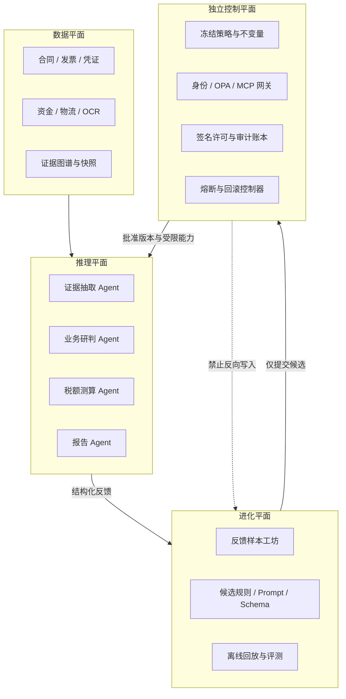
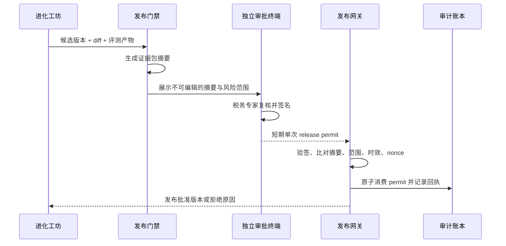
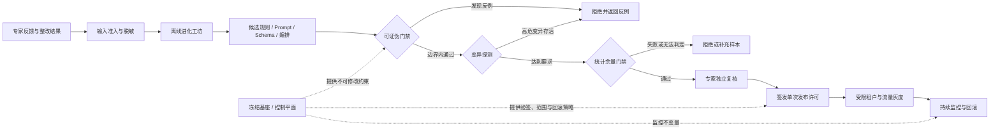
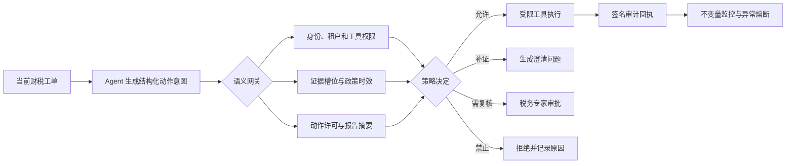

# 财税 Agent 自进化的新派安全门禁体系：从人工卡点到可验证控制平面

> 面向中税网财税风控场景，将传统“样本准入、离线评测、人工审批、灰度发布”升级为由冻结基座、可证伪发布、密码学许可、语义网关、变异探测和统计余量共同组成的双环门禁体系。

## 摘要

传统 Agent 发布流程通常采用“样本集回归、指标达标、人工审批、灰度 A/B、线上熔断”。这套机制仍然必要，但它主要回答的是：**候选版本在已知样本上看起来是否更好，以及负责人是否同意上线**。当 Agent 开始持续修改提示词、抽取 Schema、检索策略、业务规则和工具编排时，仅靠事后回归与人工卡点会暴露三个问题：历史样本覆盖不了未知反例，优化器可能逐步侵蚀约束，运行时高风险动作也可能绕过发布审批。

2025 至 2026 年的论文、工程实践和企业 Agent 网关方案呈现出一个共同方向：把安全约束从提示词和评审清单中抽离，做成 Agent 无权修改的独立控制平面；把核心业务要求写成机器可检查、可主动寻找反例的不变量；在发布和执行边界使用最小权限、短期凭证、结构化语义校验和不可篡改审计；同时用变异测试检验门禁自身是否真的有效，用置信区间和安全余量管理统计不确定性。

本文把这些实践统称为“新派门禁”。它不是某个已经标准化的单一产品名，而是一组可组合的治理模式。目标也不是证明整个大模型绝对安全，而是在明确的系统边界内证明某些状态不可到达、某些动作没有授权就无法执行，并用统计证据约束无法形式化的行为质量。

---

## 一、为什么传统“样本、评测、人工、灰度”还不够

### 1. 传统门禁解决了什么

典型的旧流程如下：

```text
专家反馈样本
  → 样本清洗和准入
  → 离线回归评测
  → 人工审核
  → 灰度 A/B
  → 指标异常时回滚
```

这套流程对控制一般的软件版本和模型版本有效，能够阻止明显退化、保留责任人并降低全量发布风险。它不应被废弃，新门禁是在其上增加更强的约束。

### 2. 自进化 Agent 带来的新风险

当系统只由工程师偶尔发布一个固定版本时，人工可以理解变更范围；当离线进化工坊每天生成大量候选规则、Prompt、Schema 和编排策略时，风险结构发生了变化。

**第一，目标优化可能侵蚀约束。** 如果优化目标只有“降低误报率”，候选策略可能通过减少高风险判定来让指标变好；如果“必须绑定证据链”只写在 Prompt 中，后续 Prompt 优化可能将其覆盖、压缩或弱化。这不是模型故意越权，而是目标函数与安全约束没有在架构上分离。

**第二，历史回归只能发现已知错误。** 一条平销返利规则可能通过所有历史样本，但在“合同名称是推广服务、结算金额仍固定为采购额 3%”的新组合上失效。历史集中没有该组合，不等于系统满足业务判定条件。

**第三，审批日志不等于授权机制。** 数据库里记录“某专家点击了同意”，并不能天然保证批准内容与最终发布内容一致，也不能防止审批结果被重复使用、跨租户使用或被脚本绕开。

**第四，发布合规不等于运行时合规。** 一个获准上线的版本，仍可能因当前证据缺失、政策超期、租户权限不同或 Prompt 注入而发起不应执行的工具调用。发布门禁约束“Agent 可以成为什么”，运行时门禁约束“Agent 此刻可以做什么”，两者不能混为一谈。

**第五，门禁本身也会失效。** 规则写错、条件从 `AND` 误改为 `OR`、测试样本标签污染、网关存在旁路，都可能让门禁变成一直放行的摆设。如果只测试 Agent 而不测试门禁，就无法知道安全网是否仍然有效。

### 3. 新旧门禁的核心区别

| 维度 | 传统门禁 | 新派门禁 |
| --- | --- | --- |
| 约束位置 | Prompt、评审清单、发布流程 | 进化循环外的独立控制平面 |
| 主要证据 | 历史样本指标、人工意见 | 形式化检查、反例、统计区间、签名凭证、审计回执 |
| 检查对象 | 候选 Agent 版本 | 候选版本、运行时动作以及门禁本身 |
| 权限模型 | 服务账号通常权限较宽 | Agent 身份隔离、工具级最小权限、上下文授权 |
| 审批语义 | 一条可查询的业务记录 | 与候选摘要绑定、短期、单次、可验证的授权能力 |
| 失败策略 | 指标下降后回滚 | 默认拒绝、无法证明则不发布、无许可则不执行 |
| 风险发现 | 在固定样本上验证 | 主动构造反例和变异样本攻击假设 |
| 目标 | 降低版本发布风险 | 让越权状态在架构上不可达，并量化剩余风险 |

一句话概括：**旧门禁偏向“提交以后再判断能不能放行”，新门禁进一步要求“Agent 没有修改底座和绕过执行边界的能力，放行结论还能被机器验证和持续攻击测试”。**

---

## 二、总体设计：四个平面、三类资产、两个闭环

### 1. 四个平面

财税 Agent 不应被实现为一个拥有全部数据和工具权限的“大 Agent”，而应明确划分四个平面。

| 平面 | 职责 | 典型内容 | 是否允许被进化流程修改 |
| --- | --- | --- | --- |
| 数据平面 | 保存业务事实与证据 | 合同、发票、凭证、资金、物流、OCR、证据图谱 | 只允许按权限读取和生成派生数据，不得篡改原始证据 |
| 推理平面 | 完成抽取、研判、测算和报告生成 | 多 Agent 编排、模型、Prompt、检索、工具调用 | 部分对象可提交候选版本 |
| 进化平面 | 从反馈中生成和评测候选变更 | 样本工坊、规则归纳、Prompt 优化、离线回放 | 可写候选仓，不能直接写生产版本 |
| 独立控制平面 | 决定什么可发布、什么可执行 | 不变量、OPA/Rego、身份权限、签名验证、审计、熔断 | Agent 与进化服务均无写权限 |

关键不在于画出四个框，而在于权限关系：**进化平面只能向候选仓提交版本，控制平面从候选仓读取并验证；控制平面的策略修改必须走独立的治理流程和人员权限。**



### 2. 三类治理资产

不是所有资产都值得使用同样昂贵的验证方式。建议按风险分为三级。

| 级别 | 资产 | 例子 | 门禁策略 |
| --- | --- | --- | --- |
| A 级：冻结资产 | 法定规则和安全根 | 政策原文、效力状态、税率、计税公式、强制复核条件、身份权限 | 架构隔离、只读、双人变更、独立发布，不进入 Agent 自进化 |
| B 级：核心判定资产 | 会改变业务定性或重大风险结论 | 平销返利要件、联营/代销判定、证据独立性、高风险升级规则 | 可证伪检查、变异测试、专家签名许可、小范围灰度 |
| C 级：一般优化资产 | 主要影响效率和表达 | 查询改写、降噪排序、Prompt 措辞、普通澄清问题、报告版式 | 统计余量、变异回归、普通审批和灰度 |

### 3. 两个闭环

新体系不是一条更长的流水线，而是两个互相约束的闭环。

- **内环：发布进化环。** 管理 Agent 可以变成什么。候选变更必须经过不变量检查、变异测试、统计评测和发布许可。
- **外环：运行执行环。** 管理已上线 Agent 此刻可以做什么。每次读取敏感数据、调用工具、形成正式报告或给出有经济后果的建议，都要经过上下文授权和语义校验。

形式化检查擅长证明边界清晰的状态机和规则属性；统计评测擅长衡量非确定模型在数据分布上的表现；人工专家负责税务定性、例外判断和责任签署。三者是互补关系，不应互相替代。

---

## 三、冻结基座门禁：让红线不在进化循环里

### 1. 原理

本文将冻结基座门禁简称为 Frozen Floor，也可理解为 immutable guardrails。这里的 Frozen Floor 是描述性工程术语，不是行业标准或特定厂商产品名。其核心不是把一句“不得修改税率”写进系统提示词，而是让进化 Agent 在网络、身份、存储和接口层都没有修改入口。

进化工坊可以产出候选规则、抽取 Schema、查询改写、Prompt、澄清策略和编排方案，但下列内容由独立控制平面保存并只读提供：

1. 税收政策原文、文号、效力区间和适用主体；
2. 税种、税率、计税依据、法定公式和申报约束；
3. 高风险事项必须由具备资质的人员复核；
4. 正式风险结论必须绑定证据、政策依据和版本快照；
5. Agent 身份、工具白名单、租户隔离和审计留存策略；
6. 发布门禁自身的规则、密钥和熔断逻辑。

### 2. 财税场景中的架构实现

冻结不等于永不更新。税法会变化，组织策略也会变化，正确做法是给冻结资产建立一条**独立于 Agent 进化的受控变更链路**：政策运营人员录入，法规专家复核，双人批准，生成新版本，按生效日期切换，旧版本只读留存。Agent 只能引用已发布版本，不能自行改变其内容或生效状态。

落地时至少需要以下隔离：

- 使用不同服务身份和存储账号，进化服务对控制库只有读权限；
- 控制平面不暴露通用写接口，只暴露特定版本发布接口；
- 密钥保存在 KMS/HSM 或独立密钥服务中，Agent 进程无法读取私钥；
- 生产策略由声明式代码管理，变更需要独立代码评审和审计；
- 关键公式由确定性代码执行，模型只负责抽取输入和解释输出；
- 正式报告发布、补税建议和进项转出建议通过强制网关，不能由内部服务直连绕过。

### 3. 与旧方案的差异

旧方案依赖“候选提交后，评审人发现它改了红线并打回”；冻结基座要求候选根本无法写入红线所在的存储和执行路径。前者是流程约束，后者是能力约束。

### 4. 能力边界

冻结基座只能保证受保护资产不被未授权修改，不能保证资产内容本身永远正确。错误的税法录入、错误的公式和错误的审批规则仍需通过独立校验、双人复核和版本回退治理。

> 面试表达：很多自进化系统的问题不是一次明显越权，而是优化器为了指标逐步把约束写进上下文、再在后续优化中抹掉。冻结基座把税法、公式、强制复核和权限策略放在进化循环之外，Agent 连写入口都没有，从架构上阻断治理漂移。

---

## 四、可证伪发布门禁：先写安全契约，再主动寻找反例

### 1. 从指标阈值升级为不变量

普通回归门禁问的是“在这批历史样本上，漏报率是否低于阈值”；可证伪发布门禁进一步问“是否存在一个可达场景，使候选策略违反预先声明的安全契约”。验收套件应在候选能力开发前或至少在发布评测前固定，候选版本不能同时改能力和放宽验收条件。

财税场景可先把核心业务要求写成结构化不变量。例如：

```text
INV-EVIDENCE-01:
risk_level = HIGH
⇒ count(independent_evidence_chain) >= 2
```

```text
INV-REBATE-01:
classification = FLAT_SALES_REBATE
⇒ contract.has_purchase_link = true
   AND rebate_basis IN {purchase_amount, purchase_quantity}
```

```text
INV-JOINT-01:
classification IN {JOINT_OPERATION, CONSIGNMENT}
⇒ pricing_right != UNKNOWN
   AND inventory_risk_owner != UNKNOWN
   AND settlement_method != UNKNOWN
   AND title_transfer_rule != UNKNOWN
```

```text
INV-POLICY-01:
report.status = FORMAL
⇒ every citation covers tax_period
   AND every citation covers taxpayer_scope
```

```text
INV-APPROVAL-01:
action IN {SUPPLEMENTARY_TAX, INPUT_TAX_TRANSFER_OUT, FORMAL_RECTIFICATION}
⇒ qualified_reviewer_approval exists
```

### 2. 验证方式

不同不变量需要不同工具，不应把所有问题都塞进 SMT 求解器。

- **JSON Schema / 类型系统**：验证字段完整性、枚举值、版本号和引用格式；
- **规则引擎 / OPA**：验证权限、上下文和组合条件；
- **属性测试**：围绕金额边界、日期边界、缺失字段自动生成样本；
- **有限状态模型检查**：验证发布、审批、回滚和许可消费状态机中不存在绕过路径；
- **SMT 求解**：验证可表达为布尔、整数、实数或有限集合约束的判定条件，并搜索满足“前提成立但结论违规”的赋值；
- **对抗样本生成**：对自然语言合同和多模态证据生成近邻反例，再由确定性判定器检查关键槽位。

以平销返利为例，可以把合同名称、采购挂钩条款、结算基数、真实服务内容和验收证据建模。求解器尝试寻找这样的反例：系统输出“推广服务费”，但付款比例始终由采购金额决定且缺少独立服务验收。一旦找到可满足的反例，候选规则就不能发布。

### 3. 门禁输出不能只有通过或失败

一套可用的发布门禁应输出：

- 被验证的不变量版本及其摘要；
- 状态空间、输入域和假设条件；
- 通过、失败或无法判定；
- 最短反例及其业务解释；
- 未覆盖的自由文本和模型行为；
- 验证工具、超时时间和产物摘要。

“无法判定”不能自动当成通过。对于 B 级核心判定资产，应进入专家复核或缩小变更范围。

### 4. 能力边界

形式化工具只能证明**模型里写出的属性，在给定假设和有限边界内成立**。它不能证明自然语言税法被完整建模，也不能证明大模型面对所有现实输入都不会幻觉。因此，形式化门禁应聚焦在稳定、可结构化、后果重大的契约上，例如证据完备性、状态流转、审批前置、公式边界和业务判定必要条件。

> 面试表达：普通回归只验证见过的样本；可证伪门禁先固定机器可检查的不变量，再主动搜索一个能让新策略破坏税法判定要件的反例。找到反例就拒绝发布，找不到也只代表在声明的模型边界内通过，不等于证明整个 LLM 绝对安全。

---

## 五、密码学单次许可门禁：让批准对象、范围和次数不可偷换

### 1. 原理

人工审批仍然必要，但审批结果不应只是一条“已同意”日志。高风险发布和运行时动作可以使用经过签名的短期许可，把审批人、批准对象、证据包、适用租户、有效期和可执行次数绑定在一起。执行网关只接受签名有效、内容匹配、尚未过期且尚未消费的许可。

密码学许可解决的是**完整性、来源认证、授权范围和不可抵赖审计**，不负责证明税务判断本身正确。专家可能签错，输入证据也可能不完整，因此许可之前仍需业务复核。

### 2. 发布许可流程



证据包至少包括候选 diff、代码和配置摘要、样本快照、评测报告、不变量检查报告、变异得分、目标租户和回滚版本。审批终端应独立于 Agent 服务，私钥不得进入 Agent 运行环境。

### 3. 许可字段示例

```json
{
  "permit_id": "rp_20261103_7f3a",
  "permit_type": "release",
  "action": "activate_candidate",
  "candidate_digest": "sha256:...",
  "evidence_bundle_digest": "sha256:...",
  "policy_version": "tax-gate-2026.11.1",
  "tenant_scope": ["retail-pilot-a", "retail-pilot-b"],
  "traffic_limit_percent": 5,
  "issuer": "tax-reviewer:zhangsan",
  "audience": "release-gateway",
  "issued_at": "2026-11-03T09:00:00+08:00",
  "expires_at": "2026-11-03T09:30:00+08:00",
  "nonce": "b660c2...",
  "rollback_version": "rebate-rule-4.8.2",
  "signature": "base64url:..."
}
```

网关验签时还要原子记录 `permit_id + nonce` 的消费状态，防止并发重放。若候选内容、评测报告、目标租户或流量比例任何一项变化，摘要就不再匹配，必须重新审批。

### 4. 区分两种许可

- **发布许可（release permit）**：批准某个候选版本在指定租户、流量和时间范围内生效；
- **运行时动作许可（action permit）**：批准当前工单执行某个有经济或法律后果的动作，例如发布正式风险报告、建议补税、建议进项转出或发送整改通知。

两者不能复用。发布许可表示版本可用，不代表该版本对每个具体客户都能自动做高风险动作。

### 5. 失败关闭与运维要求

- 验签服务不可用时，高风险动作默认拒绝，而非降级放行；
- 时钟、证书轮换、撤销列表和密钥灾备必须纳入演练；
- 审计回执要包含输入摘要、策略决定、执行结果和失败原因；
- 许可只赋予一次受限能力，不应携带可长期复用的底层凭证；
- 对同一事项要求双人复核时，可使用多签或两个独立许可。

> 面试表达：旧审批只留下“谁点过同意”的日志，新审批把“谁批准、批准哪个版本、基于哪份证据、在哪些租户和流量下生效”签进短期单次凭证。网关验签和防重放，没有匹配许可，再好的指标也不能上线。但签名证明的是授权和完整性，不是税务结论天然正确。

---

## 六、语义网关与 MCP 微分段：在动作边界执行策略

### 1. 为什么不能只过滤模型输出

Prompt 过滤和敏感词过滤发生得太晚，也缺乏业务上下文。真正需要治理的是 Agent 的能力边界：它能读取哪些数据、发现哪些工具、以什么参数调用、能否把草稿变成正式报告，以及当前证据是否足以支持这次动作。

语义网关位于 Agent 与数据、工具和报告发布服务之间，把自然语言意图投影为结构化动作，并结合主体身份、租户、工单、证据槽位、政策版本和风险等级做策略决策。MCP 提供统一的工具描述和调用接口，网关负责工具级和参数级授权；MCP 本身不是安全边界，安全来自强制经过网关、凭证托管和不存在旁路。

### 2. 按角色做微分段

| Agent 身份 | 可读 | 可调用 | 明确禁止 |
| --- | --- | --- | --- |
| 证据抽取 Agent | 当前工单的合同 OCR、发票和凭证 | OCR、字段抽取、实体归一 | 修改规则库、调用正式报告发布 |
| 业务研判 Agent | 结构化证据、图谱和只读政策索引 | 规则查询、关系验证、补证请求 | 写政策库、直接计算正式税款 |
| 测算 Agent | 已批准的事实槽位和确定性公式输入 | 只读公式服务、情景测算 | 修改税率与公式、发布正式结论 |
| 报告 Agent | 已通过校验的事实、依据和测算结果 | 草稿生成、引用校验 | 无审批发布正式报告、扩展租户范围 |
| 进化 Agent | 脱敏反馈集和候选仓 | 生成候选、离线回放 | 访问生产客户全量数据、写控制策略 |

每个 Agent 使用独立的工作负载身份，工具发现也应按身份过滤。不给未授权 Agent 返回工具定义，比让它看到工具后再提示“不要调用”更可靠。

### 3. Rego 策略示例

下面示例表达“只有报告 Agent、证据槽位齐全、至少两条独立证据链、政策仍在有效期内且具有当前工单的动作许可，才允许发布高风险正式报告”。生产实现还应校验租户、签名、数据分级和报告摘要。

```rego
package tax.agent.publish

default allow := false

required_slots := {
  "transaction_subject",
  "contract_clause",
  "invoice_flow",
  "fund_flow",
  "policy_citation"
}

allow if {
  input.principal.role == "report-agent"
  input.action == "publish_formal_report"
  input.report.risk_level == "HIGH"
  required_slots.issubset({s | input.evidence.slots[s].status == "VERIFIED"})
  count(input.evidence.independent_chains) >= 2
  input.policy.valid_for_tax_period == true
  input.action_permit.valid == true
  input.action_permit.case_id == input.case_id
}
```

网关返回的也不应只有 `allow: false`，而应提供机器可处理的原因码，例如 `EVIDENCE_SLOT_MISSING`、`POLICY_OUT_OF_PERIOD`、`PERMIT_REQUIRED`。Agent 可以据此发起补证或转人工，但不能自行把拒绝改成通过。

### 4. 语言防火墙与结构化报告

模型输出先进入受约束 Schema，而不是直接作为正式报告：

```text
事实 → 证据引用 → 业务要件 → 政策文号与效力 → 测算输入与公式版本
    → 不确定项 → 风险等级 → 整改建议 → 复核人与许可
```

若模型只输出“存在异常”但没有事实和证据映射，Schema 校验应失败；若引用文号不覆盖纳税期间，语义策略应拒绝正式化；若证据互相冲突，应输出“待核实”并转人工，不得通过措辞包装成确定结论。

### 5. 能力边界

OPA/Rego 适合对结构化输入做确定性决策，但输入语义可能被模型抽错。因此重要字段应回链到原始证据，由确定性抽取、人工复核或多源一致性验证支撑。网关也必须成为唯一执行路径；如果 Agent 仍持有后端直连凭证，再精细的策略都可被绕过。

> 面试表达：语义网关不是在答案末尾做关键词过滤，而是在读取合同、调用测算、生成正式报告这些工具边界做授权。每个 Agent 有独立身份和最小权限，网关根据证据槽位、政策时效、租户和许可判断是否执行，让 Prompt 注入最多影响建议，不能直接获得底层能力。

---

## 七、变异探测门禁：持续证明门禁真的拦得住

### 1. 为什么要测试门禁本身

回归测试通常验证“正确样本是否得到正确结果”，但门禁需要回答另一个问题：**如果系统真的出现违规变化，门禁是否会报警或拒绝？**

变异探测借鉴软件工程中的 mutation testing。测试系统主动对样本、规则、证据和授权状态做小幅但有意义的破坏，生成按设计应被拒绝的变异体，再观察门禁能否“杀死”它。若违规变异仍然通过，说明门禁存在盲区、断言过弱或执行路径可绕过。

### 2. 财税场景的变异算子

| 变异层 | 变异示例 | 预期拦截机制 |
| --- | --- | --- |
| 合同语义 | 删除返利与采购金额挂钩条款 | 平销返利不变量失败 |
| 权利义务 | 删除存货风险转移条款 | 联营/代销必要槽位失败 |
| 政策时效 | 将纳税期间改到政策生效前或失效后 | 政策适用性门禁失败 |
| 证据独立性 | 让两条“独立证据”实际来自同一份文件 | 证据链独立性检查失败 |
| 证据内容 | 篡改金额、删除验收单、制造票款不一致 | 一致性或完整性检查失败 |
| 审批状态 | 将 `APPROVED` 翻转为 `PENDING` | 运行时许可门禁失败 |
| 许可安全 | 重放已消费的 permit，或替换租户 | 防重放或 scope 检查失败 |
| 工具权限 | 让抽取 Agent 调用正式报告发布工具 | MCP 微分段拒绝 |
| 门禁规则 | 删除一个必要条件，或将 `AND` 改为 `OR` | 门禁测试套件应检测到放行增加 |

其中最后一类尤其重要：不仅变异输入，还要变异门禁代码本身。例如临时删除“至少两条独立证据链”条件，再跑安全测试；如果全部测试仍通过，说明测试集根本没有覆盖这条约束。

### 3. 变异得分与发布规则

可以定义：

```text
mutation_score = 被门禁正确拦截的有效变异体数 / 有效变异体总数
```

但总分不能掩盖关键类别。证据独立性、跨租户访问、许可重放、重大涉税事项无复核等高危变异，要求零存活；普通表达和排序类变异可以设置分层阈值。对存活变异必须分类：

- 门禁缺失，需要增加约束；
- 测试预期错误，需要专家修订；
- 变异体不成立，应标记为无效变异；
- 业务确实允许例外，需要把例外条件显式建模，而不是人工忽略。

### 4. 与对抗测试的关系

红队测试更开放，目标是发现未知攻击路径；变异测试更结构化，目标是检验已声明约束的探测能力。两者都需要，但不能互相替代。建议每次候选发布执行定向变异，每周或每月执行跨 Agent 的红队场景和旁路检查。

> 面试表达：门禁不能只当裁判，还要定期接受体检。我们会自动删合同关键条款、污染证据来源、重放许可，甚至把门禁里的 `AND` 改成 `OR`，再看安全测试能否把这些变异全部拦住。这样才能防止门禁随着规则迭代慢慢失效。

---

## 八、统计余量门禁：用区间而不是幸运的单点均值

### 1. 单点阈值的问题

假设基线高风险漏报率为 2.0%，候选版本在 500 条样本上测得 1.8%。若只比较点估计，候选看起来更优；但样本量有限、类别不均衡，1.8% 可能只是随机波动。相反，某次测得 2.1% 也可能没有统计意义，直接拒绝会阻碍有效改进。

统计余量门禁同时考虑样本量、置信区间、业务阈值和安全余量。对于“越低越好”的指标，设候选指标置信区间为 `[L_c, U_c]`，业务上限为 `T`，安全余量为 `m`：

```text
PASS:         U_c <= T - m
FAIL:         L_c > T
INCONCLUSIVE: 其他情况，需要补充样本或进入人工评审
```

这比“候选点估计小于基线”更保守，因为通过条件要求在统计不确定性之后仍留有安全空间。

### 2. 财税指标需要按风险加权

门禁不能只看整体准确率。建议至少包含：

- 高风险漏报率及其置信上界；
- 重大事项误放行率；
- 误报率、专家驳回率和重复预警率；
- 证据槽位完整率、引用有效率和结论可追溯率；
- 人工接管率、补证成功率和无法判定率；
- 工具越权拒绝率、许可重放拦截率和跨租户访问事件；
- P95 延迟、单工单成本和专家复核时长。

高风险漏报应使用更大的安全余量和更高的置信水平；普通降噪指标可以相对宽松。任何安全关键指标显著退化，都不能通过综合平均分被其他指标抵消。

### 3. 必须做切片，而不是只看总体

总体通过可能掩盖局部退化。至少按以下维度报告置信区间：

- 税种和风险事项；
- 行业与业务模式；
- 客户规模和集团复杂度；
- 数据完整度、OCR 质量和证据来源；
- 新老政策期间；
- 高风险、一般风险和提示类事项。

若某个关键切片样本太少，正确状态是 `INCONCLUSIVE`，而不是把总体指标复制过去。可以通过补充定向样本、历史回放或限制灰度范围解决。

### 4. 基线、效应量与多次试验

除了业务上限，还应与同一数据快照上的稳定基线配对比较，并报告效应量。反复生成大量候选再挑最好的一次会产生“评测集过拟合”，因此需要：

- 将开发集、门禁集和最终审计集隔离；
- 限制候选查询门禁集的次数；
- 对同一工单做配对评测，减少样本差异；
- 对低频重大风险使用精确二项区间或保守界，而非正态近似；
- 定期更换审计样本并保留时间外测试集；
- 将灰度结果视为补充证据，而不是用线上客户承担未经约束的实验。

> 面试表达：统计门禁不看一次回测的幸运均值，而看置信区间和安全余量。高风险漏报率的置信上界必须低于业务阈值减去余量；关键切片样本不足就返回无法判定，补样本后再评，而不是靠总体准确率掩盖局部风险。

---

## 九、六类门禁如何组合成双环架构

六类门禁不是六选一。冻结基座提供不可修改的安全根；可证伪门禁约束候选逻辑；变异探测验证门禁有效性；统计余量量化行为质量；密码学许可把人工决定绑定到具体对象；语义网关在运行时落实最小权限和业务语义。

### 1. 发布进化内环



推荐完整链路可以口述为：

```text
专家反馈样本
→ 输入门禁：脱敏、证据绑定、冻结资产隔离
→ 离线进化工坊生成候选变更
→ 可证伪门禁：SMT / 状态机 / 属性测试主动寻找反例
→ 变异探测门禁：攻击样本、权限、许可和门禁本身
→ 统计余量门禁：置信区间、关键切片和安全余量
→ 密码学签名审批：独立专家签发单次发布许可
→ 灰度分流：租户、行业、流量和期限受限
→ 线上持续监控：违反不变量立即熔断并回滚
```

### 2. 运行执行外环



运行时的关键原则是“默认拒绝，显式授权”：只要身份、租户、数据范围、证据、政策时效、许可或动作参数中任何一项不匹配，高风险动作就不能执行。需要补证时，系统应返回缺失项，而不是让模型自由猜测。

### 3. 各类门禁的职责边界

| 门禁 | 主要回答的问题 | 不能替代什么 |
| --- | --- | --- |
| 冻结基座 | Agent 是否有能力改动安全根 | 不能保证基座内容一定正确 |
| 可证伪发布 | 候选是否违反已声明不变量 | 不能证明未建模的现实都安全 |
| 密码学许可 | 谁批准了什么、范围和次数是否匹配 | 不能证明审批判断正确 |
| 语义网关 | 当前身份和上下文能否执行当前动作 | 不能修复错误的语义抽取 |
| 变异探测 | 门禁能否发现设计中的违规变化 | 不能穷举所有未知攻击 |
| 统计余量 | 候选在样本分布上是否有足够安全余量 | 不能提供确定性的逻辑证明 |

---

## 十、端到端案例：平销返利误报如何通过新门禁

### 1. 初始问题

旧规则发现供应商向零售企业支付一笔费用，金额约为采购额的 3%，便将其识别为平销返利并提示进项税额转出。专家复核发现其中一部分确实对应独立的门店推广服务，有服务方案、执行记录、验收材料和合理定价，属于误报。

进化工坊从专家反馈中提出候选规则：当合同名称为“推广服务协议”且存在服务验收单时，优先识别为推广服务费，从而降低返利误报。

### 2. 冻结基座先限定可修改范围

候选只能修改“业务实质识别策略”，不能修改：

- 平销返利涉及的现行政策原文和适用期间；
- 进项税额处理的确定性测算公式；
- 高风险结论必须由税务专家复核的要求；
- 正式报告必须展示事实、证据、政策和测算版本的要求。

因此，进化的目标是改善候选分类，不是通过改政策或取消复核来降低误报率。

### 3. 可证伪门禁构造反例

门禁围绕必要条件生成反例：

```text
合同标题 = 推广服务协议
有一张形式上的验收单
付款金额 = 当期采购金额 × 3%
无独立服务工作量记录
付款随采购额同步变化
```

候选规则把该场景判成推广服务费，违反“不能只根据合同名称和弱验收证据掩盖采购挂钩实质”的不变量，因此第一次候选被拒绝。

研发和税务专家据此修订策略：必须同时验证服务内容独立、实际执行、验收可核验、定价依据独立于采购金额；只要采购挂钩要素仍成立，就不得仅凭合同标题降级风险。

### 4. 变异探测攻击修订后的门禁

系统自动生成以下变异：

- 删除服务执行记录；
- 将验收单来源改为合同附件的重复页，破坏证据独立性；
- 把固定服务价格改成采购额的 3%；
- 把政策适用期间向前移动一年；
- 让两家试点租户的许可被第三家租户重放；
- 让证据抽取 Agent 直接调用正式报告发布工具。

若任一高危变异被放行，候选继续拒绝。只有关键类别全部被拦截，才进入统计门禁。

### 5. 统计余量评测

在固定时间外样本和行业切片上，对比基线与候选：

- 平销返利高风险漏报率的置信上界不得退化；
- 推广服务费误报率需要有显著下降且留出安全余量；
- 证据完整率和无法判定率不能恶化到业务不可接受；
- 对零售、制造和平台企业分别报告，不能只看总体均值。

若某一行业样本不足，候选只能在证据充分的零售业试点，不能扩展到全行业。

### 6. 签名发布与运行时控制

评测通过后，税务专家在独立终端查看候选摘要、反例修复、存活变异和切片指标，签发许可：仅限两家零售试点租户、5% 流量、有效期 14 天，回滚版本为 `4.8.2`。

运行时，即使新规则判为高风险，报告 Agent 仍需通过语义网关。证据链不足两条、政策期间不匹配或没有当前工单的动作许可时，只能输出内部草稿或补证问题，不能发布正式报告，也不能自动给出进项转出决定。

### 7. 这个案例体现的变化

旧流程关注“新规则在历史样本上是否降低误报”；新流程同时回答：它是否碰到了不可修改资产，是否存在业务反例，门禁能否拦住故意破坏，统计提升是否可靠，谁批准了哪个版本，以及具体工单是否具备执行条件。

---

## 十一、中税网的分阶段落地路径

财税场景不适合一开始就追求“全量规则形式化”。自然语言政策复杂、地方口径存在差异、业务证据质量不稳定，全面建模成本高且容易制造虚假的安全感。更实际的策略是先隔离，再结构化，再验证，最后扩大自治范围。

### 阶段一：先建立不可绕过的控制边界

目标是解决“Agent 有不该有的能力”，而不是先做复杂证明。

1. 盘点所有可进化资产，分为 A、B、C 三级；
2. 将政策原文、税率、公式、权限和强制复核条件迁出进化仓；
3. 拆分抽取、研判、测算和报告 Agent，使用独立工作负载身份；
4. 所有工具调用统一经过网关，清理后端直连凭证；
5. 正式报告、补税建议、进项转出和整改通知默认人工复核；
6. 建立版本快照、审计日志、自动回滚和紧急停机开关。

阶段验收标准不是模型准确率，而是：进化服务无法写 A 级资产；未授权 Agent 无法发现或调用高风险工具；任何正式结论都能追溯到证据、政策、公式和责任人。

### 阶段二：把核心业务要件结构化

选择高价值且边界较稳定的风险事项作为试点，例如平销返利、联营/代销、进项转出和重大涉税事项复核。

- 与税务专家共同定义必要槽位、状态枚举和证据独立性；
- 把“必须有什么”写成 Schema、规则和属性测试；
- 对发布、审批、许可消费和回滚建立有限状态模型；
- 建立反例库，保存每次门禁发现的最短反例；
- 对无法结构化的部分明确标记为人工判断，不强行伪形式化。

### 阶段三：增加变异测试和统计余量

在历史回放平台上建立可重复的变异流水线，优先覆盖缺失合同条款、政策期间错位、证据伪独立、跨租户访问、许可重放和门禁条件弱化。统计评测按风险、行业、数据完整度切片，输出置信区间和 `PASS / FAIL / INCONCLUSIVE` 三态结果。

这一阶段要特别防止评测集被进化工坊反复查询。门禁集与审计集应由控制平面托管，候选只能获得最终结果和必要反例，不能任意读取完整答案。

### 阶段四：引入签名许可并扩大受控自治

先对 B 级规则发布使用签名许可，再逐步用于有经济后果的运行时动作。第一期可以采用企业 PKI、短期 JWT/JWS、KMS 签名和防重放存储，不必等待复杂的新协议成熟。

完成技术验证后，再按风险逐步扩大自治范围：

| 动作 | 建议自治级别 |
| --- | --- |
| 生成补证清单、内部研判草稿 | 通过语义网关后可自动执行 |
| 低风险提示和无经济后果的解释 | 在批准范围内自动执行并审计 |
| 高风险正式报告 | 需要当前工单的专家动作许可 |
| 建议补税、进项转出、正式整改 | 强制人工签发动作许可，必要时双人复核 |
| 修改政策、税率、公式和安全策略 | 不属于 Agent 自治范围，走独立治理流程 |

### 团队职责建议

| 角色 | 主要责任 |
| --- | --- |
| 税务专家 | 定义业务要件、审核反例、签署正式结论 |
| 风控产品 | 确定风险分级、人工接管条件和业务阈值 |
| Agent 工程 | 生成候选、实现结构化输出和离线回放 |
| 平台安全 | 身份、网关、密钥、许可、防重放和租户隔离 |
| 测试与质量 | 变异算子、评测集隔离、统计区间和灰度验收 |
| 内审与合规 | 审计字段、留存周期、责任链和定期抽检 |

---

## 十二、门禁效果如何衡量

门禁体系的效果不能用一个“准确率”概括，需要同时衡量业务效果、安全强度和治理效率。

### 1. 业务质量指标

| 指标 | 说明 |
| --- | --- |
| 高风险漏报率及置信上界 | 最重要的安全指标，按税种和风险事项切片 |
| 误报率与专家驳回率 | 衡量降噪效果和专家负担 |
| 证据完备率 | 结论所需槽位是否齐全且可回链 |
| 引用有效率 | 文号、适用主体和纳税期间是否匹配 |
| 无法判定率 | 系统是否诚实暴露不确定性 |
| 专家复核时长 | 门禁是否提供了足够清晰的证据和反例 |

### 2. 安全门禁指标

| 指标 | 建议要求 |
| --- | --- |
| A 级资产未授权写入成功数 | 必须为 0 |
| 高危变异存活数 | 必须为 0 |
| 跨租户访问成功数 | 必须为 0 |
| 已消费许可重放成功数 | 必须为 0 |
| 无许可高风险动作成功数 | 必须为 0 |
| 门禁旁路覆盖率 | 所有高风险工具均有强制执行点 |
| 反例复现率 | 发现的反例能在固定快照中稳定复现 |
| 熔断与回滚时间 | 从不变量告警到停止影响的时间 |

### 3. 治理效率指标

- 候选从生成到结论的 P50/P95 时间；
- 因“无法判定”补充样本的比例；
- 专家审批中真正需要业务判断的比例；
- 自动拒绝的明显违规候选比例；
- 同类错误重复发生率；
- 每条候选的验证成本与生产收益；
- 门禁规则变更后的变异覆盖率。

理想状态不是让审批数量归零，而是把专家时间从检查格式、版本和权限，转移到真正需要税务判断的反例和例外上。

---

## 十三、常见反模式与风险

### 1. 把不变量继续写在 Prompt 里

Prompt 中可以重复提醒，但不能作为唯一强制层。上下文压缩、提示词优化和注入都可能改变其效果。硬约束必须在模型外的确定性执行点再次校验。

### 2. 让进化 Agent 同时修改能力和门禁

如果候选版本能修改自己的验收规则，就会出现“为了通过考试而降低及格线”。能力仓、门禁仓、密钥和审批身份必须分离，门禁变更走独立治理。

### 3. 宣称 SMT 证明了整个 Agent 安全

SMT 能验证的是被编码的约束，不是未建模的自然语言世界。所有形式化结论都应带上模型、边界、假设、超时和未覆盖项。

### 4. 把签名许可等同于正确判断

签名只能证明某个主体批准了与摘要匹配的对象。它不能证明审批人具备资质、没有误判，也不能补全缺失证据。资质校验、职责分离和业务复核仍然必要。

### 5. MCP 接入后默认所有工具可信

MCP 统一了工具协议，没有自动解决身份、授权、租户隔离、参数校验和凭证托管。每个服务器和工具仍需可信来源、最小权限、网关强制和供应链治理。

### 6. 只看总体准确率

整体提升可能来自大量低风险样本，同时掩盖重大事项漏报。安全关键指标必须单独设置不可补偿的门槛，并按行业、税种和数据完整度切片。

### 7. 门禁故障时自动放行

为了可用性将策略服务超时解释为允许，会把控制平面变成可被故意打挂的旁路。高风险动作应失败关闭，并准备人工应急流程和本地缓存的已签名策略。

### 8. 许可可长期复用或不绑定摘要

长期 token、通用审批号、只绑定版本名不绑定内容摘要，都会产生重放和偷换风险。许可需要短期、受众受限、范围受限、内容绑定并原子消费。

### 9. 变异数量很多，但没有业务意义

机械改字符并不能证明门禁有效。变异算子必须对应真实风险假设，例如删要件、破坏证据独立性、跨越政策时效、改变授权状态和模拟执行旁路。

---

## 十四、形式化、统计与人工的取舍

财税 Agent 最合理的落地策略不是“全部形式化”，而是按可结构化程度和后果分层。

### 适合形式化和可证伪门禁的对象

- 返利、联营、代销等核心判定的必要要件；
- 高风险结论的证据链数量与独立性；
- 政策生效期间、主体范围和税种适用性；
- 发布、审批、许可、防重放、回滚状态机；
- Agent 身份、工具权限和跨租户隔离；
- 确定性测算公式的输入边界和版本绑定。

### 适合统计余量和变异探测的对象

- 普通降噪规则和排序策略；
- 查询改写、召回和重排；
- Prompt 与抽取策略优化；
- 澄清问题选择；
- 自由文本解释质量；
- 对复杂合同语义的概率性判断。

### 必须保留人工责任的对象

- 重大涉税事项的最终定性；
- 证据冲突和政策适用存在争议的事项；
- 补税、进项转出和正式整改建议；
- 影响客户权益或对外提交的正式报告；
- 不变量之间发生冲突时的取舍；
- 冻结资产和控制策略的变更。

因此，建议采用三层策略：**基座不变量直接架构隔离；核心判定不变量使用形式化检查、变异探测和签名审批；普通优化使用统计余量、变异回归和灰度发布。**

---

## 十五、面试口述版本

### 1. 30 秒版本

> 传统 Agent 门禁主要是样本回归、指标阈值、人工审批和灰度，属于事后评测。财税自进化场景还需要把税法、公式、强制复核和权限策略放到 Agent 无权修改的独立控制平面；核心业务要件写成可证伪不变量，主动寻找反例；用变异测试持续攻击门禁本身，用置信区间控制统计波动；发布和高风险动作再绑定短期单次签名许可，运行时通过语义网关按 Agent 身份、证据和政策时效执行。这样 Agent 可以持续优化，但不能修改安全根，也不能绕过授权直接产生有经济后果的动作。

### 2. 2 分钟版本

> 我会把门禁拆成发布进化内环和运行执行外环。内环管 Agent 可以变成什么，外环管它现在能做什么。
>
> 第一层是冻结基座。税法原文、税率、计税公式、重大事项强制复核和工具权限放在进化循环外，进化 Agent 只有读权限，只能提交候选规则、Prompt、Schema 和编排，避免优化器为了指标逐步磨掉风控红线。
>
> 第二层是可证伪发布门禁。对平销返利、联营代销、证据链完备性这些核心要件写机器可检查的不变量，用状态枚举、属性测试或 SMT 主动寻找反例，而不只是跑历史回归。这里证明的是有限模型和声明属性，不会夸大成证明整个 LLM 安全。
>
> 第三层是门禁自测和统计余量。系统会自动删除关键合同条款、伪造证据独立性、重放许可，甚至把门禁里的 AND 改成 OR，看测试能不能拦住；行为指标则看置信区间和关键切片，高风险漏报的置信上界必须低于阈值并保留安全余量。
>
> 第四层是签名许可和运行时语义网关。专家在独立终端签发与候选摘要、租户、流量和有效期绑定的一次性发布许可；具体工单要发布高风险报告或建议补税，还需要单独的动作许可。抽取、研判、测算、报告 Agent 各有独立身份和最小权限，网关在工具边界检查证据槽位、政策时效和租户范围。
>
> 这套体系不取消人工，而是把人工从检查格式和指标，提升为只处理已经通过机器校验的反例、例外和最终责任签署。基座资产做架构隔离，核心判定做形式化加签名，普通优化走统计加灰度，成本和风险更匹配。

### 3. 面试追问：为什么不全部做形式化验证

> 因为财税政策和合同语义存在大量自然语言、地方口径和证据质量问题，完整形式化成本很高，而且模型写漏了会产生虚假安全感。我只形式化稳定、可枚举、后果重大的必要条件和状态机；概率性语义判断用分层样本、置信区间和变异测试；争议定性继续由税务专家负责。

### 4. 面试追问：签名许可和普通审批有什么实质区别

> 普通审批通常是一条可查询日志，系统仍可能发布与审批时不同的内容，或者重复使用审批结果。签名许可把候选摘要、证据包、租户、流量、有效期、受众和 nonce 绑定在一起，网关验签并原子消费。它能证明谁授权了什么范围并防止偷换和重放，但不能证明专家判断一定正确。

---

## 十六、结论

财税 Agent 自进化的关键，不是让模型拥有更大的自主修改权，而是建立一个比进化循环更稳定的控制平面。这个控制平面应当满足五个条件：安全根不可被 Agent 修改，核心约束可以被机器检查，发布和执行授权不可被偷换，门禁本身持续接受攻击测试，无法形式化的行为风险由统计区间和人工责任共同约束。

最终形成的不是“模型自己审核自己”，而是一套职责清晰的系统：Agent 负责从反馈中提出候选改进，形式化与变异门禁负责暴露反例，统计门禁负责衡量剩余不确定性，密码学许可负责固定授权事实，语义网关负责执行边界，税务专家负责业务例外和最终责任。

这也是新派门禁相对传统流程最重要的升级：**从依赖人工看一眼的软卡点，升级为 Agent 无法自行改写、可以被验证、可以被攻击、可以被审计的刚性控制平面。**

---

## 参考资料与术语口径

### 1. 论文与预印本

1. [Falsifiable Release Gates for Self-Improving Systems: Standing Invariants at Scale](https://arxiv.org/abs/2607.13070)，关于预先声明验收套件、固定不变量、有限状态空间检查和反例的 2026 年预印本。
2. [Agent Behavioral Contracts: Formal Specification and Runtime Enforcement for Reliable Autonomous AI Agents](https://arxiv.org/abs/2602.22302)，将 Design by Contract 思路应用到 Agent 行为约束和运行时执行。
3. [Runtime Compliance Verification for AI Agents](https://arxiv.org/abs/2606.19242)，以执行轨迹、策略谓词和运行时监控讨论 Agent 合规校验。
4. [Runtime Governance for AI Agents: Policies on Paths](https://arxiv.org/abs/2603.16586)，把执行路径作为运行时治理对象。
5. [Proof of Execution: Runtime Verification for Governed AI Agent Actions](https://arxiv.org/abs/2607.05397)，讨论授权、路径合规、拒绝时无副作用、历史完整性和可重放验证。
6. [Behavioral Governance for Autonomous AI Agents: The AgentBound Framework](https://arxiv.org/abs/2606.30970)，讨论委托授权、签名行为约束和站点动作契约的组合。

### 2. 工程与标准资料

1. [Open Policy Agent: Agent Tool Calling](https://www.openpolicyagent.org/docs/agent-tool-calling)，展示在 Agent harness 执行工具前，以结构化工具名和参数查询 OPA/Rego 的策略执行模式。
2. [Dapr: MCP access control](https://docs.dapr.io/developing-ai/mcp/mcp-access-control/)，介绍基于工作负载身份的 MCP 访问控制，以及结合 OPA 做工具级授权的方式。
3. [Microsoft Foundry: Govern MCP tools by using an AI gateway](https://learn.microsoft.com/en-us/azure/foundry/agents/how-to/tools/governance)，展示以 AI Gateway 统一承载 MCP 鉴权、限流、网络限制和审计的企业方案；文档标记为预览能力。
4. [IETF Internet-Draft: Signed Authorization-Evidence Records for WIMSE-Authorized AI Agent Actions](https://datatracker.ietf.org/doc/draft-munoz-wimse-authorization-evidence/)，讨论将授权决定和规范化请求绑定为签名 Permit 的个人提交草案；它仍处于 Internet-Draft 阶段，不代表 IETF 共识或标准。
5. TrueFoundry 的 [Agentic AI Security: Top 5 Risks Enterprises Should Know](https://www.truefoundry.com/blog/agentic-ai-security) 与 [What security teams actually need from an AI gateway?](https://www.truefoundry.com/blog/what-security-teams-actually-need-from-an-ai-gateway)，可作为企业侧 Agent 身份、工具访问、数据保护、护栏和审计控制的工程参考；本文不把其产品方案等同于完整的新派门禁体系。

### 3. 使用这些资料时需要说明的边界

- 本文所称“新派门禁”是对论文、标准草案和企业工程实践的综合归纳，不是已经形成共识的正式行业标准；
- arXiv 论文是预印本，IETF 链接是仍可能变化的 Internet-Draft，Microsoft 相关功能也包含预览状态，生产采用前需要重新核验最新版本；
- “Falsifiable Release Gates”来自对应预印本；“Frozen Floor”是本文对冻结基座模式的描述性简称，两者都不是已经形成共识的行业标准；
- 密码学许可部分采用可验证授权、内容摘要、短期能力和防重放的一般设计，不依赖未经可靠来源确认的产品名称；
- 统计余量门禁是对置信区间、安全余量和分层评测方法的工程归纳，不将其错误归因于某一个未核实的框架；
- 对外发表或面试引用具体实验数字前，应回到原文核对论文版本、实验条件和适用边界。
