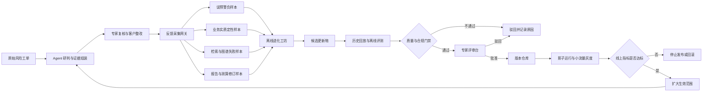
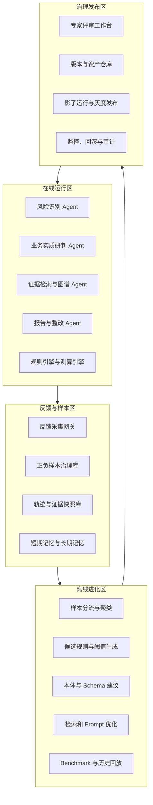

# 财税风控场景下的可控自进化 Agent：架构、闭环与落地

> 财税场景下的自进化 Agent，不是让模型自主修改业务逻辑、风控规则或税收政策库，而是在全程可审计、专家可干预、版本可回退的前提下，从历史工单、专家复核、误报样本和整改结果中持续沉淀知识与策略，提升风险检出能力，降低重复误报和专家复核成本。

## 一、为什么财税风控需要“可控自进化”

传统财税风控系统通常从指标和规则出发，例如税负率异常、进销项不匹配、收入成本波动、发票品名异常等。这类方法能够快速筛查风险，但也容易出现两个问题。

第一，指标异常不等于业务异常。同样是税负率偏低，既可能来自少计收入，也可能来自设备集中采购、固定资产大额抵扣、季节性经营或行业结算特点。如果系统只看数值偏离而不理解业务实质，就会产生大量误预警。

第二，复杂交易的税务定性依赖完整证据链。平销返利、推广服务费、联营、代销、购销、延保等业务，在资金流上可能非常相似，真正决定定性的往往是合同条款、权利义务、定价机制、存货风险、服务验收和结算方式。单靠静态规则很难穷举所有业务模式。

为解决这些问题，可以通过多模态检索、业务本体、证据图谱和规则引擎，让 Agent 在合同、发票、资金、物流、凭证及政策之间建立关联，并输出可解释的风险报告。但企业、行业和交易模式持续变化，人工一次性写全本体、规则、豁免条件和澄清问题既不现实，后期维护成本也会不断上升。

因此，系统需要建立一套受控的持续改进机制：把专家在真实工单中的驳回、修正、定性、补证和销号行为转化为高质量反馈，再将反馈沉淀为候选知识和候选策略，经离线评测、专家审核和灰度验证后进入生产链路。

这就是本文所说的**可控自进化 Agent**。

## 二、先明确边界：进化什么，不进化什么

财税场景中的“进化”主要发生在知识层和策略层，而不是让基础模型进行无监督、自主式的权重更新。

### 1. 允许进入受控进化流程的对象

| 进化对象 | 典型内容 | 生效方式 |
| --- | --- | --- |
| 财税本体 | 交易类型、业务角色、证据类型、判定槽位、实体关系 | 专家审核后发布新版本 |
| 检索策略 | 查询改写、文档切分、召回组合、重排策略 | 离线评测后灰度启用 |
| 规则与阈值 | 降噪规则、豁免条件、行业动态阈值、风险分层策略 | 双人复核或规则审批后发布 |
| Prompt 与 Schema | 合同要素抽取提示词、结构化输出字段、判定约束 | 回归评测并审核后更新 |
| 澄清策略 | 缺少何种证据时优先询问什么问题 | 专家确认后进入编排策略 |
| 实体归一资产 | 商品别名、客商别名、项目映射、同义词库 | 样本验证后版本化发布 |
| 报告资产 | 行业模板、整改路径、可解释表达、测算假设候选 | 专家审核后供辅助生成使用 |
| 工具调用策略 | 调用顺序、失败降级、补证路径、停止条件 | 在沙箱和历史回放中验证后发布 |

### 2. 严禁 Agent 自主修改的对象

1. 税收政策正文及其效力状态，包括生效、失效、废止和适用范围；
2. 税率、计税依据、税额测算公式和法定申报规则；
3. 可直接用于正式交付的风险结论、税务定性和对外报告；
4. 生产权限、安全策略、审批规则和审计留存要求；
5. 未经脱敏、授权和治理的生产数据集；
6. 未经专家审核的共享记忆、公共规则和行业知识。

模型可以发现问题、提出候选更新和生成修改建议，但不能绕过程序校验与人工审批直接改变上述对象。正式结论的责任主体仍然是经过授权的税务专家。

### 3. 与通用 Agent 自进化的区别

通用 Agent 可以通过探索和试错寻找更优路径，而税务 Agent 必须满足四个附加条件：

- **有标签**：改进信号来自明确的专家结论、复核结果或可核验业务结果；
- **有证据**：每个样本必须绑定原始材料、图谱快照和修改原因；
- **有审批**：候选更新未经专家审核不得影响生产决策；
- **有版本**：每次变化都能定位来源、评测结果、生效范围和回退版本。

因此，财税 Agent 的目标不是追求无限自主，而是让同类错误不再重复发生，让专家经验稳定地转化为组织能力。

## 三、总体闭环：从工单反馈到受控发布

整个系统可以拆分为在线研判闭环和离线进化闭环。在线链路使用已批准的知识、规则和策略处理当前工单；离线链路分析跨工单反馈，生成候选更新。两条链路通过专家评审台和版本仓库衔接，未经批准的候选内容不能进入在线链路。



这个闭环的关键不在“自动生成了多少规则”，而在于每项改进都能回答以下问题：

1. 它来自哪些工单和证据？
2. 它准备修改哪个对象？
3. 它适用于哪些行业、企业和风险类型？
4. 它在历史样本上改善了什么指标，又带来了什么风险？
5. 谁审核了它，何时生效，当前使用哪个版本？
6. 出现异常时，能否立即停用并恢复到上一个稳定版本？

## 四、四条核心进化链路

### 1. 误预警负样本驱动：优化降噪规则与动态阈值

这条链路解决“指标看起来异常，但业务实际上合理”的问题。

假设 Agent 将某企业的低税负识别为高风险，专家复核后驳回，并给出理由：“本期集中采购生产设备，形成大额进项抵扣；采购合同、固定资产发票和入库单完整，属于正常经营事项。”

系统不应只记录“本工单已驳回”，还应将本次反馈转化为可学习样本：

1. 保存风险指标、行业、企业规模、时间窗口和同群基准；
2. 保存设备采购、固定资产发票、合同和入库单等证据特征；
3. 保存 Agent 原结论、专家修正结论及驳回原因；
4. 将样本写入假阳性样本库，并与同类样本聚合分析；
5. 识别高频豁免条件或细分客群阈值偏差；
6. 生成候选降噪规则或阈值调整建议；
7. 在历史真风险和假阳性样本上同时回放验证；
8. 经专家审核后，以新版本进入规则引擎。

候选规则可以表达为：

```text
当“增值税税负显著偏低”
且“存在大额设备或固定资产进项”
且“采购合同、发票、入库或验收证据完整”
且“交易对手及资金流不存在其他异常”时，
将该指标风险由高风险降为待核验，不直接生成高风险工单。
```

这里必须强调：降噪规则只能调整风险优先级，不能仅凭单一豁免条件直接销号。任何规则更新都要同时检查真实风险的漏检变化，避免用降低召回率换取表面上的低误报率。

### 2. 业务实质判定样本驱动：完善本体、槽位与澄清策略

这条链路解决返利、联营、代销、购销和延保等复杂场景中“资金表现相似、业务实质不同”的问题。

例如，一笔供应商向经销商支付的款项，被企业记为推广服务费；专家根据合同中“返款金额与采购量挂钩”、不存在独立服务成果和验收单等证据，将其定性为平销返利。

系统需要从这次定性中提炼四类资产：

- **本体样本**：平销返利、推广服务、采购关系、结算关系及其证据关联；
- **判定槽位**：是否量价挂钩、是否存在独立服务、是否有验收成果、谁承担经营风险；
- **抽取策略**：合同中应抽取哪些关键条款，输出 Schema 是否需要新增字段；
- **澄清策略**：证据不足时，优先向业务人员询问什么问题。

系统可以进一步聚合失败案例。例如，多起联营模式识别失败都与“存货毁损和跌价责任”未被抽取有关。离线工坊可据此提出候选更新：在联营与购销模式的合同抽取 Schema 中新增“存货风险承担方”槽位，并增加相应的合同问句与示例。该槽位只有在专家确认其判定价值、完成历史回放后才能生效。

随着样本积累，Agent 不仅会在已有证据中寻找答案，也会更早发现证据缺口。例如，遇到供应商回款时，系统可以主动追问“是否存在独立服务成果及验收记录”，而不是在报告生成阶段才发现证据不足。

### 3. 证据检索与图谱对齐样本驱动：提升召回和实体归一

这条链路解决“证据存在，但系统没有找到、没有读对或没有连起来”的问题。典型反馈包括：

- 相关合同没有进入召回结果；
- 发票品名与合同品名属于同一商品，却被拆成两个节点；
- 客商简称、历史名称与统一社会信用代码未正确归一；
- 运单 OCR 识别错误，导致物流证据链断裂；
- 文档切分破坏了条款上下文，检索只召回半句话；
- 重排模型把通用制度排在具体交易合同之前。

系统应分别形成检索、抽取和归一评测集：

| 失败类型 | 回流资产 | 候选改进方向 |
| --- | --- | --- |
| 相关文档未召回 | 查询、应召回文档、实际召回列表 | 查询改写、混合检索、Embedding 或切分策略 |
| 无关文档过多 | 专家相关性标注、排序位置 | 重排模型、元数据过滤、时间与主体约束 |
| OCR 或版面抽取错误 | 原始页面、错误字段、专家修正值 | OCR 模型、版面规则、字段校验器 |
| 实体未归一 | 两个实体及其共同标识 | 别名库、匹配特征、归一模型 |
| 图谱关系错误 | 错误边、正确边、证据出处 | 关系抽取 Prompt、Schema 和一致性规则 |

对文档抽取小模型进行微调时，也必须使用隔离、脱敏并经过治理的数据集，保留训练集版本、模型版本和评测报告。线上生产数据不能未经授权直接进入训练流程。

### 4. 报告、测算与整改样本驱动：沉淀可解释交付能力

这条链路解决“风险可能判断正确，但交付不专业、不准确或不适用”的问题。常见的专家修订包括：

- 引用了已废止或不适用于当前期间的政策；
- 税款测算遗漏前提，或者默认假设与企业实际不符；
- 整改建议过于通用，不符合地产、建安、零售等行业惯例；
- 结论缺少关键反证，措辞把“风险疑点”写成了“违法事实”；
- 报告中的证据、政策、计算过程和结论无法相互追溯。

系统可将专家确认后的报告拆解为政策引用、事实摘要、证据组合、测算方法、假设条件、风险表达和整改路径，并按风险类型、行业与交易模式聚类，形成高质量 Few-shot 样本和行业模板。

但需要严格区分“可进化的表达与假设资产”和“不可自动修改的法定规则”：

- Agent 可以学习专家如何组织证据和解释结论；
- Agent 可以推荐适用的测算模板及待确认假设；
- Agent 不能修改税率、法定公式和政策效力；
- 任何测算结果必须展示数据来源、公式版本和假设条件；
- 正式报告发布前必须由税务专家复核确认。

## 五、系统架构与核心组件

可控自进化能力不应散落在各个 Agent 中，而应作为独立的平台能力建设。整体上可分为在线运行区、反馈与样本区、离线进化区、治理发布区四个区域。



### 1. 反馈采集网关

反馈采集不能只依赖专家额外填写标签，而要把日常工单操作转化为天然监督信号。网关需要捕获驳回、接受、修改定性、调整风险等级、替换政策、修改测算、新增证据、手动销号、升级处置等动作。

不过，操作行为不应被直接等同于最终标签。例如，专家删除一段报告，可能是因为表达冗余，也可能是因为事实错误。系统需要结合操作类型、字段差异、复核意见和工单最终状态解释反馈，必要时要求专家补充结构化原因。

### 2. 样本治理库

一个可用于进化的样本至少应包含：

| 字段 | 含义 |
| --- | --- |
| 样本与工单标识 | 关联原始任务、企业、期间和风险类型 |
| 输入快照 | 当时使用的数据、文档、图谱和政策版本 |
| 执行轨迹 | Agent 版本、Prompt、模型、工具调用与中间结果 |
| 原始输出 | 当时的风险结论、证据链、测算和报告 |
| 专家修订 | 修改后的结论、字段差异和补充证据 |
| 反馈标签 | 真阳性、假阳性、漏报、证据不足、定性错误等 |
| 修订原因 | 专家给出的结构化原因及必要说明 |
| 适用范围 | 行业、企业类型、交易模式、税种、时间范围 |
| 审计信息 | 操作人、时间、审批记录和留存策略 |

样本必须版本锁定。若原始政策、合同解析结果或图谱后来发生变化，也不能覆盖历史状态，而应生成新版本，以保证能够还原“系统当时基于什么作出判断”。

### 3. 离线进化工坊

离线工坊负责把反馈转化为候选资产，而不是直接更新生产环境。其核心任务包括样本聚类、错误归因、规则挖掘、本体缺口发现、Prompt 候选生成、检索参数搜索和历史回放。

每个候选更新都应附带一张“变更卡”：

- 变更对象与版本；
- 来源样本和问题描述；
- 候选内容及适用范围；
- 与当前版本的差异；
- 离线评测结果；
- 已知风险和不适用条件；
- 建议的灰度范围与回滚条件。

### 4. 专家评审工作台

评审台是财税自进化的强制闸门。专家需要能够查看候选规则的自然语言解释、机器表达、命中样本、反例、指标变化和受影响场景，并执行批准、修改、驳回或要求补充评测。

高风险资产应采用分级审批。例如，检索同义词可以由知识运营人员审核；影响风险等级的规则需要税务专家审核；涉及跨行业共享或测算逻辑的变更需要更高级别的双人复核。

### 5. 版本、灰度与回滚

所有本体、规则、Prompt、检索配置、模板和记忆资产都需要独立版本号，并记录依赖关系。一次线上研判应能够还原所使用的完整版本组合。

税务场景不宜一开始就让新策略直接影响正式结论。更稳妥的发布顺序是：

1. **离线回放**：在冻结的历史评测集上与当前版本对比；
2. **影子运行**：新旧策略同时运行，新策略结果不影响工单；
3. **专家辅助**：新策略仅提供候选建议，由专家决定是否采用；
4. **小范围灰度**：限定行业、风险类型和专家团队逐步启用；
5. **扩大范围**：指标持续达标后再扩大覆盖面。

一旦出现高风险漏报、政策引用错误、异常工单激增或证据链完整度下降，系统应触发停止发布或自动回滚，并保留新旧版本的对照记录。

### 6. 记忆与上下文持久化

系统可以设置两类记忆：

- **短期记忆**：单个工单中的对话、已核验证据、澄清历史、待办事项和当前判断；
- **长期记忆**：经专家确认的企业业务标签、稳定交易模式、行业本体、别名词典和已批准经验。

短期记忆服务于当前任务恢复，长期记忆服务于跨任务复用。单次对话中的推断不能自动写入共享长期记忆；企业级标签也需要注明来源、有效期和适用范围，并允许专家纠正或失效处理。

## 六、财税场景的质量与合规闸门

候选更新从生成到上线，至少应通过以下六道闸门。

| 闸门 | 核心检查 | 不通过后的处理 |
| --- | --- | --- |
| 数据闸门 | 授权、脱敏、样本完整性、标签可信度 | 隔离或退回补充 |
| 证据闸门 | 候选结论是否能追溯到原始证据 | 禁止进入评测 |
| 政策闸门 | 政策效力、适用期间、地域和主体是否正确 | 退回政策维护人员 |
| 质量闸门 | 漏报、误报、召回、准确率是否满足阈值 | 淘汰或重新优化 |
| 专家闸门 | 专家是否批准内容与适用范围 | 保留为候选，不得发布 |
| 发布闸门 | 灰度指标、异常监控、回滚方案是否完备 | 暂停扩大范围 |

其中最重要的是双约束评测：**先守住漏风险率，再优化假阳性率。** 如果一个新规则显著降低工单量，却同时漏掉更多真实风险，它不能被视为有效进化。

此外，还应防止反馈闭环自身产生偏差。例如，专家更容易复核高风险工单，低风险样本长期缺少标签；某一行业样本量过大，可能导致规则向该行业过拟合；客户整改并不必然证明 Agent 原判断正确。离线评测集应按行业、企业规模、税种、风险类型和时间分层，并保留独立的盲测集。

## 七、指标体系：证明系统是真的在变好

自进化效果不能用“新增了多少规则”或“积累了多少样本”衡量，而应同时观察风险质量、证据质量、专家效率和系统治理四类指标。

### 1. 风险识别指标

| 指标 | 定义 | 关注点 |
| --- | --- | --- |
| 漏风险率 | 已确认真实风险中未被系统检出的比例 | 核心安全指标，优先控制 |
| 假阳性率 | 系统预警中被专家确认无风险的比例 | 衡量误预警与专家负担 |
| 风险检出率 | 已确认真实风险中被系统识别的比例 | 应按行业和风险类型分层 |
| 风险分级准确率 | 系统风险等级与专家最终等级的一致程度 | 避免只看是否命中 |
| 重复错误率 | 已有同类反馈后再次发生相同错误的比例 | 直接反映经验是否真正复用 |

### 2. 证据与研判指标

- 关键证据召回率；
- Top-K 文档命中率和重排质量；
- 实体归一准确率；
- 合同关键槽位抽取准确率与完整率；
- 证据链完整度；
- 政策引用的有效性与适用性；
- 结论、证据、政策和测算之间的可追溯率。

### 3. 专家效率指标

- 单工单平均复核时长；
- 专家修改字段数和修改比例；
- 平均补证轮次；
- 同类工单一次通过率；
- 每百个工单需要人工升级的数量；
- 专家对候选规则的接受率及接受后的实际收益。

### 4. 进化治理指标

- 候选更新通过率；
- 从反馈产生到版本发布的周期；
- 灰度回滚率；
- 版本回归失败率；
- 样本与变更的审计链完整率；
- 已发布资产的有效复用次数；
- 因样本漂移、政策变化而失效的规则数量。

所有指标都应与当前生产基线对比，并给出样本量、置信区间和分层结果。模型或策略存在随机性时，应进行多次运行，避免用单次结果证明改进。

## 八、一个端到端示例：低税负误预警如何完成进化

下面用一条低税负误预警说明完整链路。

### 第一步：系统生成风险工单

风险识别 Agent 发现企业本期增值税税负显著低于行业基准，结合进销项数据生成高风险工单。

### 第二步：专家补充证据并驳回

专家发现企业本期采购了大型生产设备，固定资产发票、合同、付款和验收材料完整，因此将工单调整为低风险，并填写“设备集中采购导致进项抵扣增加”。

### 第三步：反馈被结构化采集

反馈网关记录风险指标、原结论、修改结果、驳回原因、新增证据和专家身份，同时冻结当时的图谱、规则和 Prompt 版本。

### 第四步：离线工坊聚合同类样本

系统发现过去三个月存在多起相似驳回，且共同特征是设备类进项集中、合同与验收完整、无其他资金和发票异常，于是生成候选降噪规则。

### 第五步：历史回放验证

候选规则在历史样本上回放。结果显示假阳性率下降，但其中两起真实风险也存在设备发票，只是合同主体与付款主体不一致。系统据此补充反向条件：若主体、资金或物流存在异常，则不得降档。

### 第六步：专家审批并限定适用范围

税务专家审核规则表达、正反例和指标变化，将其适用范围限定为制造业设备采购场景，并批准进入影子运行。

### 第七步：影子运行与灰度上线

新规则先只生成对比结果，不改变现有工单。影子阶段未发现新增漏报后，系统再对小范围工单启用“高风险降为待核验”的辅助建议。

### 第八步：持续监控与回滚准备

平台监控专家驳回率、漏风险率、证据完整度和复核时长。一旦出现真实风险漏检或跨行业误用，立即停用该版本并恢复旧规则。

这个案例说明，自进化不是“从一个驳回样本直接学出一条规则”，而是完成从反馈采集、样本聚合、反例验证、专家审批到灰度发布的完整治理过程。

## 九、分阶段落地路径

### 第一阶段：建立可观测、可回放的工单基线

先统一工单标识、反馈类型、证据引用和版本信息，完整记录 Agent 输入、工具调用、输出与专家修改。此阶段不追求自动生成规则，重点是让每次判断都可还原、每次修订都可解释。

优先建设：

- 反馈采集网关；
- 正负样本治理库；
- 基础离线评测集；
- 规则、Prompt、模型和政策版本追踪；
- 专家驳回原因的结构化标签。

### 第二阶段：从误预警降噪和检索失败切入

这两类问题标签相对清晰、收益容易衡量、对正式税务定性的侵入较小，适合作为首批进化场景。

可以先实现：

- 高频假阳性场景聚类；
- 候选豁免条件发现；
- 文档未召回与无关召回评测；
- 商品和客商别名库扩充；
- 影子运行和人工辅助建议。

### 第三阶段：完善业务本体与主动澄清

在样本和证据图谱稳定后，再从专家定性中提炼判定槽位，优化合同抽取 Schema 和澄清问题。这个阶段应聚焦少数高价值场景，如平销返利、联营、代销和延保，避免一次覆盖所有业务类型。

### 第四阶段：沉淀行业报告与整改资产

将专家确认后的报告、测算假设和整改方案转化为行业化模板，同时建立政策效力校验和测算引擎硬约束。系统可提升初稿质量，但正式交付仍由专家审批。

### 第五阶段：形成跨场景的进化运营体系

当单场景闭环稳定后，再建设统一的资产目录、评测平台、发布流程和治理看板，支持不同税种、行业和 Agent 共享经过验证的知识与策略。

## 十、落地中的关键风险

### 1. 把专家操作误当成绝对真值

专家也可能出现判断分歧或操作错误。高影响样本应经过复核，争议样本应保留多方意见，不能直接进入训练集或规则挖掘流程。

### 2. 为了降低误报而牺牲真实风险

工单量下降并不代表系统更好。必须把漏风险率设置为硬约束，并对高风险类型设置更严格的发布阈值。

### 3. 候选规则过拟合少数企业

企业级记忆、行业规则和公共规则要分层管理。只适用于单一客户的经营模式，不能未经验证上升为行业通用规律。

### 4. 新策略污染历史可追溯性

历史工单应保留当时使用的版本和输入快照，不能用最新本体或政策回写并覆盖原始判断环境。

### 5. 反馈闭环被错误样本放大

候选规则影响新工单后，新工单又会成为后续样本。如果缺少独立评测和人工闸门，早期错误可能在闭环中被不断放大。因此，生产反馈、训练样本和独立测试集必须隔离管理。

## 十一、总结

财税风控的难点，不只是把政策放进知识库，也不只是增加更多指标规则，而是持续理解企业真实业务，并将风险结论建立在可核验的事实、证据、政策和计算过程之上。

可控自进化 Agent 为这个问题提供了一条现实路径：

**专家工单反馈 → 样本治理 → 候选知识与策略 → 离线双约束评测 → 专家审批 → 影子运行与灰度发布 → 线上监控与回滚。**

它进化的是本体、规则、检索、Prompt、澄清策略、工具编排和交付模板，而不是让模型自由修改政策、公式和正式风控结论。它追求的也不是完全替代税务专家，而是把专家的重复判断转化为可复用资产，让相同错误少发生一次，让同类证据更早被找到，让复杂交易的业务实质更容易被说明。

最终衡量这套系统的标准不是“Agent 是否更自主”，而是：在不突破合规红线的前提下，真实风险是否仍能被稳定检出，误预警是否持续下降，证据链是否更完整，专家复核是否更高效，以及每一次系统变化是否都可解释、可审计、可回退。

## 十二、面试口述精简版

> 财税强合规场景下，自进化 Agent 不能自主修改规则、政策和正式风控结论。我们的路线是可控的知识与策略进化，而不是让基座模型自由微调。
>
> 整套系统会把税务师在工单上的复核、驳回、定性修正、证据补充和整改结果自动采集为反馈信号，再分流到四条进化链路：第一，利用假阳性样本优化降噪规则和动态阈值；第二，利用业务定性样本完善财税本体、判定槽位、合同抽取和主动澄清策略；第三，利用证据召回和实体对齐失败样本优化多模态检索、OCR 与图谱归一；第四，把专家修订后的报告沉淀为行业化解释模板、测算假设候选和整改方案库。
>
> 所有候选更新都先在历史评测集上验证。评测时先约束漏风险率，再优化假阳性率；通过后进入专家评审台，人工批准后先做影子运行，再小范围灰度。如果出现高风险漏报、政策引用错误或证据链质量下降，系统立即停用或回滚。
>
> 这套机制解决的是规则写不完、行业场景不断新增和专家经验难复用的问题。它不追求无人化定性，而是让 Agent 在专家可控、全程留痕的前提下越来越懂业务，减少重复误报和重复复核，把个人经验沉淀为组织能力。
