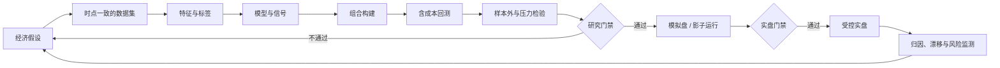

# 量化交易：从策略研究、回测验证到实盘风控

> 量化交易的核心不是用复杂模型预测下一根 K 线，而是把一个可以证伪的市场假设，转化为经过数据校验、样本外检验、成本约束和风险控制的交易系统。
>
> 文档类型：量化研究与工程实践指南｜文献检索截至：2026 年 11 月 4 日

## 摘要

量化交易以数据、统计模型和程序化执行为手段，把投资判断转化为可重复运行的规则。它覆盖的并不只是“寻找买卖信号”，而是一条完整链路：提出假设、治理数据、构造特征、验证信号、形成组合、模拟成交、控制风险、发送订单、核对持仓，并在实盘后持续监测模型和市场是否已经变化。

这条链路中，预测通常不是最难的部分。真正困难的是避免未来信息泄漏和幸存者偏差，区分样本内拟合与样本外能力，把换手率、冲击成本和资金容量纳入研究，以及在行情异常、接口故障和模型失效时限制损失。White 的数据窥探检验、Harvey 等人对“因子动物园”的研究，以及 Bailey 等人提出的回测过拟合概率都说明：尝试的策略越多，找到一条历史上漂亮的曲线越容易，但它属于真实规律的概率未必更高。[8-10]

本文以中低频股票量化为主要示例，同时覆盖趋势跟踪、统计套利、做市和机器学习选股。全文重点回答四个问题：策略收益可能来自哪里，研究结论怎样才可信，纸面收益怎样转化为可交易收益，以及一个量化系统如何进入可监控、可审计、可回滚的实盘状态。

> 本文用于研究和工程讨论，不构成投资建议、收益承诺或法律意见。市场规则、交易费用和产品适当性要求应以监管机构、交易所及经纪商的最新文件为准。

## 一、量化交易不是预测模型，而是决策系统

### 1. 从观点到规则

主观投资与量化投资都需要判断。区别在于，量化交易要求把判断写成明确规则，使另一个研究者在同样的数据和假设下可以复现结果。例如，“选择经营质量好、估值低且趋势向上的公司”仍然只是观点；只有继续定义股票池、质量指标、估值口径、动量窗口、再平衡频率、权重上限和成交价格，它才成为可以验证的策略。

一套完整的量化决策可以表示为：

```text
市场假设 -> 可观测数据 -> 特征与信号 -> 目标持仓 -> 交易订单
        -> 实际成交 -> 收益与风险归因 -> 模型监测与迭代
```

其中任何一环不成立，预测准确率都不能自动转化为利润。研究者可能正确预测了收益方向，却因为价差和冲击成本亏损；也可能找到有效因子，却因组合约束把暴露抵消；还可能在回测中使用了当时尚未发布的财务数据，使全部结果建立在未来信息之上。

### 2. 收益必须按净值口径讨论

策略在时间区间内的净损益可以简化为：

$$
\text{Net PnL}
= \text{Position PnL}
+ \text{Carry}
- \text{Commission}
- \text{Spread Cost}
- \text{Market Impact}
- \text{Borrowing and Financing Cost}
$$

回测中最常被高估的是第一项，最常被忽略的是后五项。特别是高换手、小市值和高频策略，毛收益只要轻微下降或成交成本估计稍有偏差，净收益就可能由正转负。Novy-Marx 和 Velikov 对市场异象的研究表明，考虑交易成本后，许多账面显著的异象缺乏可交易性。[11]

因此，评价一个策略至少需要同时回答：

1. **经济来源是什么**：风险补偿、行为偏差、流动性供给、信息处理，还是制度约束；
2. **统计证据是否稳健**：是否跨时期、跨市场、跨参数和样本外成立；
3. **交易后是否仍有收益**：费用、价差、冲击、税费和融券成本是否已计入；
4. **风险是否可承受**：回撤、尾部损失、拥挤交易和流动性枯竭时会发生什么；
5. **系统是否能可靠执行**：订单、持仓、资金和行情异常能否被发现并控制。

### 3. 四种不同层次不能混为一谈

| 层次 | 核心问题 | 常见错误 |
| --- | --- | --- |
| 预测模型 | 某资产未来收益、波动或成交概率是多少 | 用准确率替代经济价值 |
| 交易策略 | 在什么条件下买卖，持有多久 | 没有成本和成交假设 |
| 投资组合 | 多个信号和资产如何分配风险 | 忽略相关性与集中度 |
| 生产系统 | 如何稳定取得数据、下单、监控和恢复 | 把回测脚本直接接入实盘 |

机器学习模型只是预测层的一个组件。即使模型在测试集上有增量解释力，也需要经过组合构建、成本约束、执行和风险控制才能成为策略。反过来，简单信号配合稳健的组合和执行，往往比复杂但脆弱的模型更有实际价值。

## 二、研究闭环：让每一步都能被复现和否定

量化研究不应从“找一个指标试试看”开始，而应从可证伪假设开始。例如：投资者对新信息反应不足，可能导致中期动量；机构调仓和止损行为可能导致跨资产趋势延续；短期流动性冲击可能使相关资产价格暂时偏离。假设决定数据、持有期和风险，而不是在观察回测曲线后反向编故事。



### 1. 研究立项卡

在写代码前记录以下内容，可以显著减少事后选择：

| 字段 | 应回答的问题 |
| --- | --- |
| 假设 | 为什么可能存在收益，谁在承担另一侧 |
| 标的与市场 | 股票、期货、期权还是数字资产；可交易范围是什么 |
| 时间尺度 | 信号多久形成、多久衰减、多久调仓 |
| 必需数据 | 数据当时何时可得，修订历史能否恢复 |
| 主要风险 | 市场、风格、流动性、杠杆、模型和操作风险 |
| 基线 | 等权、市场指数、简单线性模型或已有生产策略 |
| 验收标准 | 样本外收益、回撤、换手、容量和稳定性门槛 |
| 否决条件 | 在什么结果下停止，而不是继续调参 |

研究日志还应记录每次试验的代码版本、数据快照、参数、随机种子和结果。没有试验历史，就无法知道最终策略是在十次还是一万次尝试中胜出，也无法正确理解显著性。

### 2. 三道门禁

**研究门禁**判断信号是否有经济解释、是否通过样本外和稳健性检验。**模拟门禁**判断数据能否准时到达、订单能否生成、成本和成交假设是否接近真实。**实盘门禁**判断权限、限额、监控、对账、熔断和人工接管是否齐备。

这三道门禁分别回答“是否可能有效”“是否能够交易”和“是否能够安全运行”。一条策略不应因为回测夏普比率较高就跳过后两道门禁。

## 三、数据工程：回测可信度首先取决于时间

### 1. 时点一致性比数据量更重要

量化数据必须回答两个时间问题：

- **事件时间（event time）**：财报、成交或新闻所描述的事件发生在何时；
- **可用时间（available time）**：交易系统实际能在何时收到并使用这条数据。

例如，某公司年报描述的是 12 月 31 日的财务状态，但可能在次年 3 月才发布；数据供应商又可能在发布数小时后才完成标准化。若回测从 12 月 31 日起使用该指标，就产生未来信息泄漏。正确的数据集应保存原始发布日期、供应商入库时间和后续修订版本，并按研究时点执行 point-in-time 查询。

### 2. 六类典型数据偏差

| 偏差 | 表现 | 控制方法 |
| --- | --- | --- |
| 未来信息泄漏 | 使用未来价格、未来财报或全样本归一化参数 | 按可用时间切片，所有变换只在训练窗口拟合 |
| 幸存者偏差 | 只使用今天仍上市的证券 | 保存历史成分、退市证券和名称代码变更 |
| 复权错误 | 重复或遗漏分红、拆股、配股影响 | 明确价格收益和总收益口径，逐事件核验 |
| 选择偏差 | 看完结果再决定起止时间和样本 | 预注册区间与规则，保留全部试验记录 |
| 标签重叠 | 相邻样本共享未来收益区间 | 使用隔离窗口、降采样或考虑相关性的统计方法 |
| 数据修订偏差 | 使用数据库最新值代替当时公布值 | 使用版本化宏观和财务数据 |

行情数据还要处理停牌、涨跌停、集合竞价、错误报价、零成交、跨市场时区和交易日历。清洗规则必须区分“异常数据”和“异常市场”：2020 年极端波动、流动性枯竭或负价格可能是真实事件，不能因为破坏模型表现就被删除。

### 3. 数据契约

每个生产数据集都应有明确契约：

```yaml
dataset: equity_daily_bar
primary_key: [instrument_id, trade_date]
event_time: market_close_time
available_time: vendor_received_at
timezone: Asia/Shanghai
price_adjustment: raw_and_total_return
late_data_policy: quarantine_then_rebuild
quality_checks:
  - unique_primary_key
  - high_gte_max_open_close
  - low_lte_min_open_close
  - non_negative_volume
  - trading_calendar_coverage
lineage:
  source: licensed_vendor
  transform_version: git_commit
```

数据质量不只看缺失率，还应监测延迟、覆盖率、重复键、横截面分布漂移、公司行动一致性以及不同数据源之间的价格差异。任何一次回测都应能定位到不可变的数据版本；否则同一份代码在一个月后可能得到不同结论。

## 四、策略谱系：收益来源、假设与失效方式

策略分类的意义不是给算法贴标签，而是识别它依赖什么市场行为、暴露什么风险，以及何时最可能失效。

### 1. 横截面因子

横截面策略在同一时点比较多个资产，做多预期收益较高的一组，低配或做空另一组。Fama 和 French 的三因子模型把股票收益解释为市场、规模和价值暴露；Jegadeesh 和 Titman 记录了中期赢家继续跑赢输家的动量现象；Asness 等人进一步发现价值和动量在多个资产类别中具有共性。[2-5]

常见因子包括：

| 因子 | 常见代理变量 | 可能解释 | 主要风险 |
| --- | --- | --- | --- |
| 价值 | 账面市值比、盈利收益率、自由现金流收益率 | 风险补偿或过度悲观 | 价值陷阱、行业结构偏差 |
| 动量 | 过去 6 至 12 个月收益，跳过最近月 | 信息反应不足、资金持续流入 | 快速反转和拥挤平仓 |
| 质量 | 盈利能力、现金流质量、杠杆、稳定性 | 优质企业被低估或风险较低 | 定义分散、财务修订滞后 |
| 低波动 | 历史波动率、Beta、特异波动 | 杠杆约束和彩票偏好 | 利率敏感、行业集中 |
| 规模 | 流通市值或总市值 | 流动性与经营风险补偿 | 成本高、容量低、退市风险 |

因子收益不等于因子名称。一个“价值策略”可能实际上暴露于银行、周期股和小市值；一个“低波策略”可能集中持有公用事业。研究必须做行业、市值、Beta 和其他已知因子的归因，判断收益来自目标信号还是意外暴露。

### 2. 时间序列动量与趋势跟踪

时间序列策略比较同一资产当前状态与其历史状态。Moskowitz、Ooi 和 Pedersen 在股票指数、债券、外汇和商品期货中记录了时间序列动量。[4] 常见信号包括移动平均突破、过去收益符号和波动率标准化趋势：

$$
s_{i,t}=\frac{r_{i,t-L:t-1}}{\hat{\sigma}_{i,t}}
$$

波动率标准化可以防止高波动资产天然占据组合大部分风险，但也会在波动率突然上升前形成过高仓位。趋势策略通常在持续行情中获利，在震荡和快速反转中反复止损。其评估不能只看平均收益，还要观察危机期表现、跨资产相关性、调仓速度和期货换月成本。

### 3. 均值回归与统计套利

均值回归策略假设价格偏离某个相对价值后会收敛。Gatev 等人的配对交易先根据历史价格距离选择相似股票，再在价差偏离时建立相反头寸，是统计套利的经典基准。[6]

更一般的研究会检验协整关系：

$$
z_t = p_{A,t} - \beta p_{B,t}
$$

若 $z_t$ 在统计上平稳，可以根据标准化偏离建立仓位。但协整不是永恒关系。公司基本面变化、指数调整、并购预期或行业制度变化都可能造成结构断点。仅用全样本估计 $\beta$ 会泄漏未来信息；只根据相关系数配对，也不能保证价差均值回归。

### 4. 做市与流动性供给

做市策略同时提供买卖报价，以价差补偿库存风险、逆向选择和订单取消风险。Avellaneda 和 Stoikov 将库存、波动率和订单到达强度纳入最优报价框架。[14] 这类策略的关键不是方向预测，而是：

- 订单在队列中的位置及成交概率；
- 成交后价格向不利方向移动的概率；
- 库存能否在风险限额内及时回到目标；
- 延迟、撤单失败和行情丢包时的最大损失。

使用分钟线或收盘价无法可信回测做市。至少需要订单簿、逐笔成交、撮合规则、队列模型和端到端延迟估计。若数据无法支持这些假设，应明确放弃对高频收益的精确声称。

### 5. 事件驱动

事件驱动策略围绕财报、分红、指数调整、并购、分析师修正和政策事件构建。其难点是事件时间、预期基准和可交易性。财报“增长”本身不是意外信息，只有相对于市场预期的偏差才可能形成信号；新闻发布时间若精确到日而非秒，也不能用于分钟级回测。

不同策略的证据要求不同。中低频因子需要 point-in-time 基本面和历史成分；统计套利需要结构稳定性检验；做市需要微观结构数据；事件策略需要精确时间戳和预期数据。不能用一套日线回测器为所有策略背书。

## 五、机器学习：预测能力必须经过经济约束

Gu、Kelly 和 Xiu 系统比较了线性模型、树模型和神经网络在股票风险溢价预测中的表现，发现机器学习能够捕获高维变量之间的非线性关系和交互作用；Krauss 等人则比较了深度神经网络、梯度提升树和随机森林在统计套利任务中的表现。[7][16] 但机器学习不会自动解决金融数据的低信噪比、非平稳性和交易成本问题，反而会扩大数据泄漏与过拟合的空间。

### 1. 先定义预测对象

模型目标应与交易决策一致。常见标签包括：

- 未来 $h$ 期绝对收益；
- 相对行业或市场的超额收益；
- 收益横截面分位数；
- 未来实现波动率；
- 订单成交概率或市场冲击；
- 极端下跌、流动性枯竭等风险事件概率。

均方误差最低的收益模型不一定形成最优组合。模型可能准确预测大量接近零的小波动，却错过少数决定盈亏的尾部事件。实践中应同时评估排序相关性、分组收益、换手、成本后效用和最差时期表现。

### 2. 时间切分是硬约束

随机打乱样本会把未来市场状态混入训练集。更合理的方式是滚动或扩展窗口：

```text
训练 2012-2016 -> 验证 2017 -> 测试 2018
训练 2012-2017 -> 验证 2018 -> 测试 2019
训练 2012-2018 -> 验证 2019 -> 测试 2020
...
```

标准化、缺失值填充、特征选择和超参数搜索都必须在每个训练窗口内完成。若标签跨越未来 20 个交易日，训练集与验证集边界还应留出隔离区，避免重叠标签共享未来价格。

### 3. 复杂模型要击败简单基线

建议按以下顺序增加复杂度：

1. 等权或单因子分组；
2. 线性回归、岭回归或逻辑回归；
3. 树模型和梯度提升；
4. 神经网络、表征学习或集成模型，例如使用自编码器学习条件因子结构。[17]

每一层都应证明样本外、成本后和风险调整后的增量。DeMiguel、Garlappi 和 Uppal 对资产配置方法的比较表明，参数估计误差可能让理论上的最优模型输给简单的 $1/N$ 等权组合。[12] 简单基线不是低标准，而是检验复杂度是否真正创造价值的必要对照。

### 4. 可解释性服务于诊断

特征重要性不能证明因果，但可以帮助发现异常：模型是否过度依赖规模，是否只在某行业有效，是否使用了数据供应商的编码痕迹。至少应检查：

- 分时期、分行业和分市值的特征贡献；
- 特征值轻微扰动后预测是否剧烈变化；
- 重要特征的数据发布时间是否可靠；
- 模型收益是否可被常见因子解释；
- 输入分布漂移时，预测置信度是否同步下降。

模型版本必须和特征定义、训练数据快照及超参数共同登记。只保存一个二进制模型文件，无法满足复现、审计和回滚要求。

## 六、回测：模拟当时能够做出的决策

回测不是把信号与未来收益相乘，而是在历史时点重放数据、决策和订单状态。可信回测应保证策略在每个时点只能看到当时可得的信息，并按市场规则判断订单能否成交。

### 1. 向量化与事件驱动

| 方式 | 优点 | 局限 | 适用场景 |
| --- | --- | --- | --- |
| 向量化回测 | 快速、易于批量研究 | 难表达订单状态和部分成交 | 日频因子初筛、资产配置 |
| 事件驱动回测 | 可模拟行情、信号、订单和成交事件 | 实现复杂、运行较慢 | 盘中策略、执行算法、实盘前验证 |
| 撮合级仿真 | 可处理订单簿、队列和延迟 | 数据与计算成本高，模型仍有误差 | 做市和高频策略 |

早期研究可以用向量化框架快速排除无效想法，但进入模拟盘前，应使用与实盘共享订单模型和风控逻辑的事件驱动框架复核。两个框架结果若明显不同，通常说明成交、再平衡或状态处理存在隐含假设。

### 2. 成交模型不能默认“下一根开盘全成”

成交价格至少受到以下因素影响：

$$
P_{fill}=P_{reference}+\frac{spread}{2}\cdot direction
+ impact(q, ADV, \sigma)+delay\_move
$$

其中 $q$ 是订单量，$ADV$ 是平均日成交额，$\sigma$ 是波动率。实际模型还要考虑参与率、限价、涨跌停、停牌、部分成交和撤单。若策略在收盘后才取得数据，就不能按同日收盘价成交；若买入量占当日成交额很高，也不能假设全部成交且没有冲击。

交易成本应做多情景测试，而不是只给一个点估计。例如分别使用正常、压力和极端三档价差与冲击参数，观察策略是否只有在最乐观假设下才盈利。

### 3. 关键指标及其边界

年化收益和波动率可分别写为：

$$
R_{ann}=\left(\frac{V_T}{V_0}\right)^{Y/T}-1,
\qquad
\sigma_{ann}=\operatorname{std}(r_t)\sqrt{N}
$$

夏普比率为：

$$
Sharpe=\frac{R_p-R_f}{\sigma_p}
$$

最大回撤为：

$$
MDD=\max_t\left(1-\frac{V_t}{\max_{s\le t}V_s}\right)
$$

这些指标都依赖样本。收益非独立同分布、存在自相关或尾部风险时，简单年化可能误导。报告至少还应包含：

| 维度 | 指标 |
| --- | --- |
| 收益 | 年化收益、超额收益、月度胜率、收益分布 |
| 风险 | 年化波动、最大回撤、回撤持续时间、VaR/ES、偏度和峰度 |
| 效率 | 夏普、Sortino、Calmar、信息比率 |
| 交易 | 换手率、成交额占比、平均持有期、成本占毛收益比例 |
| 暴露 | Beta、行业、国家、货币、久期、规模及风格因子 |
| 稳定性 | 分年份、分市场状态、分参数、分资产和样本外表现 |
| 容量 | 不同资金规模下的冲击成本和净收益 |

### 4. 对抗过拟合

White 指出，从大量模型中挑选历史表现最优者会产生数据窥探偏差；Harvey 等人认为，在检验大量因子时，传统显著性门槛过低；Bailey 等人则给出了估计回测过拟合概率的方法。[8-10] 实践中应组合使用以下措施：

1. 先写假设、参数范围和验收标准，再运行最终检验；
2. 保留一个不参与特征和参数选择的最终样本；
3. 报告全部主要试验，而不是只报告最佳结果；
4. 检查参数平台是否宽而平稳，而非只有一个尖锐最优点；
5. 在其他市场、时期或相邻资产上寻找可迁移证据；
6. 对收益序列进行区块自助法或适合时间序列的稳健推断；
7. 对成本、延迟、缺失数据和极端行情做压力测试；
8. 将多重检验次数纳入显著性与策略选择判断。

真正的样本外只有一次。一旦研究者查看结果并据此修改策略，该区间就已经参与训练，应被视为新的样本内信息。

## 七、组合构建：把预测转化为可承受的风险

Markowitz 的均值—方差框架奠定了用预期收益、风险和相关性共同构建组合的基础。[1] 现代量化组合在此基础上进一步加入交易成本、流动性、因子暴露和稳健性约束。

### 1. 从原始分数到可交易权重

因子通常先经过去极值、缺失处理、标准化和中性化。以横截面标准分为例：

$$
z_{i,t}=\frac{x_{i,t}-\operatorname{median}(x_t)}{1.4826\cdot MAD(x_t)}
$$

使用中位数和绝对中位差可降低极端值影响。多个因子可以按固定权重、历史信息系数、风险预算或模型预测组合，但组合方式也必须只使用当时数据。行业中性化可以降低行业押注，却也可能移除信号真实的经济来源，因此中性化前后结果都应报告。

### 2. 优化目标必须包含交易摩擦

一个常见的组合优化形式是：

$$
\max_w\quad
\hat{\mu}^{\top}w
-\lambda w^{\top}\Sigma w
-\gamma\lVert w-w_{prev}\rVert_1
-\eta\,Cost(w-w_{prev})
$$

并满足：

$$
\sum_i w_i=1,\quad
l_i\le w_i\le u_i,\quad
Aw\le b
$$

第一项是预期收益，第二项惩罚组合风险，第三、四项控制换手和非线性成本；约束可以覆盖单票、行业、风格、Beta、杠杆、流动性和融券可得性。若优化器频繁把权重推到边界，往往意味着预期收益或协方差估计不稳定，而不一定是“最优机会”特别明确。

### 3. 估计误差往往比优化误差更大

预期收益很难估计，协方差矩阵在资产较多、历史较短时也容易病态。实务中常用收缩估计、因子协方差、权重上限和稳健优化降低敏感性。还应把等权、分层等权和简单风险缩放作为基线。

组合构建的目标不是榨取回测中的最后一点收益，而是让输入发生合理误差时，持仓和风险不会剧烈改变。一个需要精确预测到小数点后多位才能成立的最优组合，通常不适合生产。

## 八、交易执行：信号衰减与市场冲击之间的权衡

组合给出“希望持有什么”，执行系统决定“以什么代价变成该持仓”。如果信号衰减很快，交易过慢会损失机会；如果订单相对市场成交量较大，交易过快会推高冲击成本。执行问题因此是机会成本与市场冲击之间的动态权衡。

### 1. 交易成本分解

市场冲击并不只是经验上的“滑点”。Kyle 的连续竞价模型刻画了信息交易、订单流与价格形成之间的关系，为理解订单为何改变价格提供了经典微观结构基础。[18] 一次买入的实施缺口可写为：

$$
IS = Q(P_{fill}-P_{decision}) + Fees + OpportunityCost
$$

$P_{decision}$ 是作出投资决定时的价格，$P_{fill}$ 是实际成交均价；未成交部分造成机会成本。实施缺口比“相对收盘价好坏”更接近策略真实损失，因为它从决策时刻开始计量。

Almgren 和 Chriss 将大额订单执行建模为预期成本和价格风险的权衡。[13] 实务中的成本通常包括：

| 成本 | 形成原因 | 主要控制手段 |
| --- | --- | --- |
| 显性费用 | 佣金、税费、交易所和清算费用 | 费率管理、市场与通道选择 |
| 买卖价差 | 立即成交需要跨越盘口 | 限价单、被动成交、时机选择 |
| 临时冲击 | 本方订单消耗订单簿流动性 | 限制参与率、拆单、跨时段执行 |
| 永久冲击 | 交易向市场传递信息并改变均衡价格 | 减少可预测下单模式、控制规模 |
| 延迟成本 | 决策后价格在下单前移动 | 缩短链路、按信号半衰期决定优先级 |
| 机会成本 | 限价或慢速执行导致未成交 | 动态调整激进程度和截止时间 |

### 2. 算法名称不等于执行质量

TWAP 按时间均匀拆单，VWAP 跟随预期成交量曲线，POV 控制在市场成交量中的参与比例，Implementation Shortfall 算法则根据剩余时间、风险和冲击动态安排。它们只是执行框架，不保证获得更好价格。

算法选择应取决于订单规模、信号半衰期、流动性形态、价格风险和是否允许未完成。对隔夜慢因子，降低冲击可能比抢先成交重要；对几分钟衰减的事件信号，慢速 VWAP 可能把全部 Alpha 让给市场。

### 3. 执行质量需要事后归因

每个母单应保存决策价、到达价、成交明细、未成交量、市场成交量和基准曲线。执行归因至少区分：

- 信号产生到订单到达之间的延迟损失；
- 订单执行期间的市场共同波动；
- 本方交易造成的冲击；
- 限价和风控约束导致的机会成本；
- 经纪商、算法、市场和时段差异。

Hendershott、Jones 和 Menkveld 对算法交易与市场流动性的研究说明，算法交易的市场影响需要在实际微观结构中评估，而不能简单等同于“更快”或“更低成本”。[15]

## 九、风险管理：限制不可逆损失，而不是消灭波动

风险管理的目标不是让净值不波动，而是防止单一错误、极端行情或系统故障造成超过资本和流动性承受能力的损失。风险应在组合形成前、订单发送前、成交后和日终对账四个阶段控制。

### 1. 风险分层

| 风险类型 | 典型表现 | 关键控制 |
| --- | --- | --- |
| 市场风险 | Beta、利率、汇率、波动率或基差不利变化 | 暴露限额、对冲、压力测试 |
| 因子风险 | 价值、动量、规模或行业集中 | 因子归因、中性约束、风险预算 |
| 流动性风险 | 无法按估计价格平仓，冲击成本激增 | ADV 限额、清算天数、流动性分层 |
| 杠杆与融资风险 | 保证金上升、融资撤回、强制减仓 | 杠杆上限、现金缓冲、融资情景测试 |
| 模型风险 | 数据漂移、参数失效、错误假设 | Champion/Challenger、版本和停用门禁 |
| 操作风险 | 重复下单、漏单、断线、错误证券代码 | 幂等键、状态机、双向对账、熔断 |
| 合规风险 | 未报告、异常报撤单、违反账户或市场规则 | 规则引擎、审批、审计日志、定期核验 |

### 2. 盘前、盘中与盘后控制

**盘前控制**检查标的是否可交易、订单数量和价格是否合理、账户资金是否充足、单票与行业暴露是否超限、预计参与率是否过高。它必须在订单进入交易通道前同步执行。

**盘中控制**监测实时损益、净敞口、成交偏差、订单速率、撤单率、行情新鲜度和经纪商连接。超过硬限额时，系统应拒绝新订单、仅允许减仓，必要时执行全局 Kill Switch。

**盘后控制**核对内部订单、经纪商成交、托管持仓、现金和费用，完成收益归因并记录所有限额突破。对账差异不能仅靠第二天人工修正，因为未识别的仓位会在下一个交易日继续产生风险。

### 3. 回撤响应不能临时决定

策略上线前应定义回撤分级，而不是亏损后凭情绪决定：

| 状态 | 触发示例 | 响应 |
| --- | --- | --- |
| 正常 | 指标位于预期范围 | 按既定风险预算运行 |
| 观察 | 损失或偏离接近预警线 | 冻结扩容，检查数据、成本和暴露 |
| 降险 | 超过统计预期但未发现系统错误 | 分阶段降低风险预算，只允许受控调仓 |
| 停止 | 数据错误、模型版本异常或突破硬限额 | 停止开仓，保留可审计状态并人工接管 |
| 恢复 | 根因确认、修复验证和审批完成 | 小规模恢复，逐级放量 |

纯粹根据近期亏损立即关闭策略，可能在低点退出；无条件坚持模型，又可能把结构性失效误认为普通回撤。正确做法是将净值回撤与信号有效性、成本、暴露、数据质量和市场状态一起诊断。

### 4. 压力测试应改变相关性与流动性

只把历史波动率乘以两倍并不足够。极端时期往往同时出现相关性上升、价差扩大、成交量下降、融资条件收紧和模型信号同向。压力场景应覆盖：

- 历史危机重放及更严重的倍数场景；
- 相关性向 1 收敛或对冲关系断裂；
- 价格跳空、连续涨跌停和停牌；
- ADV 下降、价差扩大、冲击系数上升；
- 保证金和融券费率上调，融资额度收缩；
- 行情延迟、经纪商拒单、重复回报和部分市场不可用。

压力测试的产出不是一张最大亏损表，而是明确哪些限额会先触发、哪些仓位无法及时退出、系统如何降险以及需要多少流动性缓冲。

## 十、实盘架构：研究代码不能直接充当交易系统

研究环境追求试验速度，生产环境追求确定性、审计和故障隔离。两者可以共享因子定义、组合逻辑和数据接口，但不能共享随意可变的 Notebook 状态。


### 1. 系统边界

| 组件 | 主要职责 | 不应承担的职责 |
| --- | --- | --- |
| 数据层 | 采集、校验、版本、时点查询和血缘 | 临时修正策略信号 |
| 信号服务 | 按固定版本计算预测和置信度 | 直接绕过组合层下单 |
| 组合服务 | 目标权重、约束和风险预算 | 猜测订单是否成交 |
| OMS | 母单、子单、成交和撤单状态 | 重新训练模型 |
| EMS | 选择市场、价格和执行节奏 | 修改投资目标仓位 |
| 风控服务 | 限额检查、降险和熔断 | 用人工脚本静默放行 |
| 账本与对账 | 持仓、现金、费用和外部事实核对 | 依赖单一系统自证正确 |

订单必须有全局唯一且可幂等的标识。网络重试不应产生第二笔经济意义相同的订单；迟到的成交回报也不能使订单状态从“已成交”倒退为“部分成交”。状态转换、人工操作和限额豁免都应写入不可变审计日志。

### 2. 可观测性必须覆盖业务事实

CPU、内存和接口延迟只能说明系统是否运行，不能说明交易是否正确。量化系统还应监测：

- 行情和特征的新鲜度，是否使用了上一交易日数据；
- 当日信号数量、分布、缺失率和相对历史漂移；
- 目标持仓与实际持仓差异；
- 订单拒绝、撤单、部分成交和异常重试；
- 实时损益与理论损益差异；
- 成本、滑点和参与率相对模型的偏差；
- 内部账本与经纪商、托管方记录的差异。

告警必须对应可执行动作。行情过期应阻止依赖该行情的新信号；对账不平应冻结相关账户继续开仓；成本模型持续低估时应自动降低容量估计，而不是只发送一封无人处理的邮件。

### 3. 发布与恢复

模型和策略发布应保留版本化制品、数据依赖、配置差异、审批记录和回滚目标。推荐采用：

```text
离线回放 -> 模拟盘 -> 影子信号 -> 小资金/低风险预算
        -> 分阶段放量 -> 常态运行
```

影子模式使用真实时钟和数据生成订单但不发送，能够发现研究环境看不到的数据延迟、节假日、标的映射和状态问题。恢复时优先恢复可确认的持仓、现金和订单状态，再恢复模型服务；若经济状态未知，系统宁可停止开仓，也不应依据猜测继续交易。

## 十一、上线后监测：区分随机亏损、执行偏差与模型失效

回测结束不是研究结束。实盘数据提供了新的样本外证据，也会暴露回测模型没有覆盖的摩擦。监测系统应把问题分为数据、信号、组合、执行和市场五层，避免净值下跌时直接归咎于“模型失效”。

### 1. 从损益到原因

日度损益可以按以下路径归因：

```text
总损益
├── 市场与基准收益
├── 行业、国家、Beta 和风格因子收益
├── 证券选择收益
├── 汇率、利息、分红与期限收益
├── 交易成本与融资成本
└── 残差：数据、估值、执行或模型未解释部分
```

若毛 Alpha 正常但净 Alpha 下滑，优先检查换手、价差和冲击；若预测排序能力下降，检查特征分布和市场结构；若理论持仓赚钱而实际持仓亏损，检查执行、漏单和对账；若各策略同时亏损，检查共同因子、流动性和拥挤暴露。

### 2. 三类漂移

- **数据漂移**：输入特征的分布、缺失率或覆盖率变化；
- **关系漂移**：相同特征与未来收益之间的关系减弱或反转；
- **执行漂移**：成交率、滑点、冲击和延迟偏离回测假设。

数据漂移不一定意味着策略失效，可能只是市场进入新状态；关系漂移也不应仅凭短期信息系数为负就确认。应结合统计显著性、经济解释、历史状态和替代模型，设置观察、降险、停止与恢复门槛。

### 3. 策略健康度面板

| 层级 | 领先指标 | 滞后指标 |
| --- | --- | --- |
| 数据 | 延迟、缺失、分布、异常值 | 因数据问题造成的重算和损失 |
| 信号 | 覆盖率、分散度、预测置信度 | IC、分组收益、命中率 |
| 组合 | 约束占用、集中度、预计换手 | 风险调整收益、实际回撤 |
| 执行 | 订单积压、参与率、拒单和延迟 | 实施缺口、冲击、机会成本 |
| 风险 | 暴露、保证金、清算天数 | 压力损失、限额突破和尾部损失 |

领先指标用于在损益出现前识别风险，滞后指标用于验证策略是否兑现预期。单独盯住实时 PnL 会让团队在随机波动中频繁干预，却错过数据过期和流动性恶化等更早的信号。

## 十二、中国市场的程序化交易合规边界

中国证监会发布的《证券市场程序化交易管理规定（试行）》自 2024 年 10 月 8 日起施行，建立了程序化交易报告、交易监测、风险管理、系统与机房管理、高频交易差异化监管以及沪深港通相关管理框架。[19] 2025 年发布的《期货市场程序化交易管理规定（试行）》则将相应要求扩展到期货市场。[20]

合规不是在策略上线前补一份表格，而应进入数据、研究、订单和审计架构。建设系统时至少应落实以下能力：

1. **主体与账户识别**：明确哪些账户、策略和控制关系属于程序化交易报告范围；
2. **先报告后交易**：维护报告信息、变更记录和可交易状态，未经必要报告不得启用；
3. **策略与系统治理**：保存策略逻辑、技术系统、服务器位置、测试和上线审批记录；
4. **异常交易监控**：监测瞬时申报速率、频繁报撤单、异常价格和可能影响市场秩序的行为；
5. **高频交易管理**：识别是否达到适用标准，并支持差异化费用、额外报告和系统控制；
6. **应急与审计**：保留订单、撤单、成交、参数、版本和人工操作记录，支持调查和追溯；
7. **市场差异配置**：把证券、期货及各交易所业务规则做成版本化规则，而非写死在策略代码中。

法规给出总体要求，交易所实施细则、会员和经纪商接口规范决定具体报告字段、阈值与操作流程。团队应建立规则清单并指定负责人按市场持续更新。本文不能替代持牌机构的合规审查，也不应把任何示例阈值理解为监管阈值。

## 十三、案例：构建一个质量—价值—动量股票组合

本案例展示研究流程，不给出虚构的回测收益。目标是构建一个月度调仓、仅做多、相对宽基指数控制行业和规模偏离的多因子组合。最终结果必须由实际 point-in-time 数据、费用和市场规则计算。

### 1. 研究假设与范围

假设是：盈利质量较好、估值相对较低且中期价格趋势较强的股票，可能在未来一个月至一个季度获得更高的横截面收益；质量约束有助于减少低估值中的财务困境公司，价值与动量的组合有助于分散单一因子的周期性。[2-5]

研究约束如下：

| 项目 | 示例定义 |
| --- | --- |
| 股票池 | 每个历史时点可投资的指数成分或满足流动性条件的上市股票 |
| 排除项 | 停牌、不可交易状态、上市不足一定期限、数据缺失严重的标的 |
| 调仓 | 每月最后一个可计算日生成信号，下一可交易时段开始执行 |
| 质量 | 毛利率、资产收益率、经营现金流质量、杠杆稳定性 |
| 价值 | 盈利收益率、账面市值比、自由现金流收益率 |
| 动量 | 过去 12 个月减最近 1 个月的总收益 |
| 组合 | 仅做多，行业和规模受控，单票、换手和流动性设上限 |
| 基准 | 同期可投资宽基指数及简单等权因子组合 |

“历史时点可投资”是关键。若使用今天的指数成分回测过去，就会删除后来退市或被剔除的公司；若财务指标按报告期而非发布日期生效，就会泄漏未来信息。

### 2. 特征处理

每个调仓日按以下步骤处理：

1. 根据当时的上市状态、停牌信息、价格和成交额形成股票池；
2. 只连接在调仓日前已经公开且可由系统取得的财务记录；
3. 在行业内对原始指标做温莎化或稳健去极值；
4. 将方向统一，使分数越高代表预期越好；
5. 计算稳健标准分，并记录缺失值处理标记；
6. 在质量、价值、动量组内聚合，再组合成总分；
7. 对行业、市值及 Beta 暴露做回归诊断，必要时中性化；
8. 将分数连同数据版本、特征版本和可用时间写入不可变快照。

组合分数可以从固定等权开始：

$$
Score_i=\frac{1}{3}Quality_i+\frac{1}{3}Value_i+\frac{1}{3}Momentum_i
$$

只有当滚动样本外证据表明动态权重在不同成本和市场状态下稳定胜出时，才考虑使用 IC 加权或机器学习组合。不能先在全样本上寻找最优因子权重，再把它描述为“先验配置”。

### 3. 组合与交易规则

初始基线可选择总分最高的一组股票等权持有，然后逐步加入约束：

```python
for rebalance_date in calendar:
    universe = point_in_time_universe(rebalance_date)
    fundamentals = published_fundamentals(universe, as_of=rebalance_date)
    prices = total_return_history(universe, end=rebalance_date)

    quality = build_quality(fundamentals)
    value = build_value(fundamentals, prices)
    momentum = build_momentum(prices, lookback_months=12, skip_months=1)

    score = robust_zscore(quality + value + momentum)
    target = optimize(
        expected_return=score,
        previous_weight=current_position,
        risk_model=point_in_time_risk_model(rebalance_date),
        constraints=[long_only, single_name_cap, sector_band,
                     turnover_cap, liquidity_cap],
        cost_model=calibrated_cost_model(rebalance_date),
    )
    orders = target_to_orders(target, current_position)
    simulate_or_execute_after_signal_time(orders)
```

这段伪代码刻意把 `as_of` 和 `after_signal_time` 写出来，因为它们比模型名称更能决定回测是否可信。生产实现还需要处理不可成交证券、最小交易单位、公司行动、现金、税费、部分成交和残余订单。

### 4. 回测与稳健性矩阵

主结果之外至少运行以下对照：

| 检验 | 目的 |
| --- | --- |
| 单因子、双因子和三因子组合 | 判断收益是否由单一因子驱动 |
| 等权与优化组合 | 判断优化器是否真正增加净收益 |
| 不同行业中性强度 | 识别行业配置贡献与代价 |
| 月度、双月和季度调仓 | 观察信号衰减与换手成本 |
| 正常、压力、极端成本 | 检查收益对成本估计的敏感性 |
| 大中小市值分层 | 判断容量和规模暴露 |
| 牛市、熊市、震荡和高波动期 | 检查市场状态依赖 |
| 滚动样本外窗口 | 评估参数随时间的稳定性 |
| 延迟一日或多日成交 | 检查收益是否只存在于不可实现时点 |

验收门槛应在最终测试前确定。可从“样本外成本后超额收益为正、回撤在风险预算内、成本压力下仍不过度恶化、收益不集中于极少数年份或股票、容量覆盖目标资金规模”五个维度定义，而不应只设一个夏普比率阈值。

### 5. 从模拟盘到实盘

模拟盘至少应完整经历若干次调仓，核对：

- 财务和行情数据能否在预期时间稳定到达；
- 股票池、停牌和公司行动处理是否与市场一致；
- 目标持仓、订单和实际可成交数量是否一致；
- 实际观察到的价差、冲击和成交率是否接近回测；
- 风控拒单、部分成交和剩余订单如何反馈到下一次组合计算；
- 收益归因能否解释基准、因子、证券选择和交易成本。

实盘初期使用低风险预算并设置扩容门禁。只有当实际成本、信号表现、系统稳定性和对账连续满足预设标准，才逐级增加资金；资金规模变化后需要重新估计冲击和容量，不能按回测收益线性外推。

## 十四、从研究到上线的 12 周路线

下面的周期适合已有基本数据和交易通道的中低频策略试点。高频、期权和跨市场策略需要更长的数据、仿真及合规准备时间。

### 第 1 至 2 周：定义问题与数据审计

- 完成研究立项卡、经济假设、基线和否决条件；
- 列出数据源、事件时间、可用时间、修订规则和授权边界；
- 重建历史股票池、公司行动和交易日历；
- 建立最小数据质量报告和不可变数据快照。

交付物不是一条收益曲线，而是可复现的数据集和一份明确说明“什么结果会让项目停止”的研究协议。

### 第 3 至 5 周：信号与基线回测

- 从最简单的因子定义和等权组合开始；
- 分解分组收益、IC、换手和行业、市值暴露；
- 校验信号产生时间与最早可成交时间；
- 建立正常、压力和极端成本情景；
- 记录全部试验和参数，不删除失败结果。

### 第 6 至 7 周：样本外与稳健性检验

- 执行滚动样本外检验和时间隔离；
- 改变参数、调仓频率、股票池和中性化强度；
- 检查收益是否集中于少数时期、行业或证券；
- 估算资金容量与清算天数；
- 由未参与建模的研究者复核数据和回测逻辑。

### 第 8 至 9 周：事件驱动回放与影子运行

- 将信号接入组合、风控、OMS 和执行模拟；
- 使用真实交易时钟运行但不发送订单；
- 演练停牌、涨跌停、部分成交、断线和迟到回报；
- 对比模型成本、仿真成本和实时观察成本；
- 验证持仓、现金、费用和经纪商记录的对账流程。

### 第 10 至 12 周：受控上线

- 完成合规报告、权限、审批和策略版本冻结；
- 使用低风险预算上线，禁止绕过盘前限额；
- 监测信号、执行、损益和对账的完整健康度；
- 演练 Kill Switch、仅减仓模式、回滚和人工接管；
- 根据预设门禁决定扩大、保持、降险或停止。

## 十五、常见失败方式

### 1. 从技术指标出发，事后寻找故事

在大量窗口、阈值和指标组合中筛选最优曲线，几乎一定能找到“有效策略”。若没有预先假设、试验记录和多重检验控制，这只是数据窥探，不是证据。

### 2. 用最新数据库重建过去

今天可见的股票、财务数据和行业分类都包含历史修订。缺少 point-in-time 数据时，回测会系统性高估可用信息和可投资范围。

### 3. 只报告毛收益和夏普比率

不报告换手、成本、最大回撤、容量、暴露和样本外表现，就无法判断收益能否交易，也无法知道承担了什么风险。

### 4. 把机器学习分数直接变成仓位

预测分数没有处理相关性、集中度、流动性和交易成本。模型输出必须经过校准、组合构建和风险约束，才能形成目标仓位。

### 5. 使用过于理想的成交假设

信号在收盘后计算，却按同一收盘价成交；大额订单按中间价全部成交；涨跌停和停牌被当作缺失值删除。这些假设会把不可交易收益写进回测。

### 6. 用一个最优参数代替稳健区域

只有某个精确窗口或阈值盈利，邻近参数立即失效，通常说明策略在拟合噪声。生产策略更需要宽而平缓的有效参数区域。

### 7. 回测框架与实盘逻辑分叉

研究代码按目标权重计算收益，实盘系统却受最小交易单位、资金、拒单和部分成交影响。两套逻辑长期分叉后，回测不再代表可执行策略。

### 8. 用止损替代风险建模

止损只能在市场允许成交时执行，跳空、跌停和流动性枯竭会使实际损失远超阈值。仓位、杠杆、相关性和流动性限额必须在建仓前控制。

### 9. 策略上线后只看净值

净值是多种因素叠加后的滞后结果。缺少数据、信号、暴露和执行归因时，团队无法区分普通回撤、成本上升、系统错误与结构性失效。

### 10. 把合规当作人工流程

当账户、策略、参数和订单规模增加后，依赖人工记忆执行报告、限额和审计要求必然失效。合规规则需要版本化，并进入发布门禁、订单检查和日志体系。

## 十六、结论

量化交易首先是一门控制证据质量的学科，其次才是模型和编程。一个策略值得进入实盘，不是因为历史曲线平滑，而是因为它具有可解释的收益来源，使用了当时真实可得的数据，在样本外和成本压力下仍然成立，风险和容量与目标资金匹配，并能在故障时被及时停止和恢复。

从工程角度看，可靠的量化系统有三条贯穿始终的链路：

1. **证据链**：从假设、数据、试验到样本外结论，每一步可以复现；
2. **交易链**：从信号、目标持仓、订单到成交和对账，每一步状态明确；
3. **控制链**：从限额、监测、告警到降险和恢复，每一步可以审计。

复杂模型可以提高预测能力，却不能替代这三条链路。反过来，一条逻辑简单、成本可控、风险分散且稳定运行的策略，已经具备量化交易最重要的专业特征。

## 附录 A：研究报告最小目录

一份可评审的量化研究报告至少应包含：

1. 经济假设与收益可能来源；
2. 市场、标的、时间尺度和交易限制；
3. 数据来源、授权、时点、修订和质量报告；
4. 特征、标签、模型和全部关键参数；
5. 训练、验证、测试与隔离方式；
6. 基线模型和增量贡献；
7. 成交、费用、价差、冲击和融资假设；
8. 收益、风险、换手、暴露和容量；
9. 参数、时期、市场状态和成本压力测试；
10. 失败试验、多重检验和已知局限；
11. 模拟盘结果与回测差异；
12. 上线门禁、限额、停止和恢复条件。

## 附录 B：实盘上线检查清单

### 数据与模型

- [ ] 所有输入都有事件时间、可用时间、质量规则和负责人；
- [ ] 数据、特征、模型、配置和代码版本能够一一对应；
- [ ] 未使用未来信息、最新成分股或修订后数据回填历史；
- [ ] 样本外结果、成本压力和容量测试已通过评审；
- [ ] 模型输入异常时有降级或停止策略。

### 交易与风险

- [ ] 信号时间、订单时间和允许成交时间定义清楚；
- [ ] 盘前限额无法被策略代码绕过；
- [ ] 重试具备幂等性，迟到和重复回报经过测试；
- [ ] 部分成交、拒单、停牌和涨跌停处理明确；
- [ ] Kill Switch、仅减仓模式和人工接管已经演练；
- [ ] 资金、持仓、成交与费用能够日内或日终对账。

### 监控与治理

- [ ] 数据、信号、组合、执行和风险均有健康度指标；
- [ ] 每条关键告警都有负责人、响应动作和升级路径；
- [ ] 策略、账户、系统和高频属性已按适用规则报告；
- [ ] 订单、撤单、成交、参数变化和人工操作可审计；
- [ ] 回滚版本、恢复步骤和上线审批记录完整。

## 参考文献

[1] Markowitz, H. (1952). Portfolio Selection. *The Journal of Finance*, 7(1), 77-91. [DOI](https://doi.org/10.1111/j.1540-6261.1952.tb01525.x)

[2] Fama, E. F., & French, K. R. (1993). Common Risk Factors in the Returns on Stocks and Bonds. *Journal of Financial Economics*, 33(1), 3-56. [DOI](https://doi.org/10.1016/0304-405X(93)90023-5)

[3] Jegadeesh, N., & Titman, S. (1993). Returns to Buying Winners and Selling Losers: Implications for Stock Market Efficiency. *The Journal of Finance*, 48(1), 65-91. [DOI](https://doi.org/10.1111/j.1540-6261.1993.tb04702.x)

[4] Moskowitz, T. J., Ooi, Y. H., & Pedersen, L. H. (2012). Time Series Momentum. *Journal of Financial Economics*, 104(2), 228-250. [DOI](https://doi.org/10.1016/j.jfineco.2011.11.003)

[5] Asness, C. S., Moskowitz, T. J., & Pedersen, L. H. (2013). Value and Momentum Everywhere. *The Journal of Finance*, 68(3), 929-985. [DOI](https://doi.org/10.1111/jofi.12021)

[6] Gatev, E., Goetzmann, W. N., & Rouwenhorst, K. G. (2006). Pairs Trading: Performance of a Relative-Value Arbitrage Rule. *Review of Financial Studies*, 19(3), 797-827. [DOI](https://doi.org/10.1093/rfs/hhj020)

[7] Krauss, C., Do, X. A., & Huck, N. (2017). Deep Neural Networks, Gradient-Boosted Trees, Random Forests: Statistical Arbitrage on the S&P 500. *European Journal of Operational Research*, 259(2), 689-702. [DOI](https://doi.org/10.1016/j.ejor.2016.10.031)

[8] White, H. (2000). A Reality Check for Data Snooping. *Econometrica*, 68(5), 1097-1126. [DOI](https://doi.org/10.1111/1468-0262.00152)

[9] Harvey, C. R., Liu, Y., & Zhu, H. (2016). ... and the Cross-Section of Expected Returns. *Review of Financial Studies*, 29(1), 5-68. [DOI](https://doi.org/10.1093/rfs/hhv059)

[10] Bailey, D. H., Borwein, J. M., López de Prado, M., & Zhu, Q. J. (2016). The Probability of Backtest Overfitting. *Journal of Portfolio Management*, 42(4), 75-92. [DOI](https://doi.org/10.3905/jpm.2016.42.4.075)

[11] Novy-Marx, R., & Velikov, M. (2016). A Taxonomy of Anomalies and Their Trading Costs. *Review of Financial Studies*, 29(1), 104-147. [DOI](https://doi.org/10.1093/rfs/hhv063)

[12] DeMiguel, V., Garlappi, L., & Uppal, R. (2009). Optimal Versus Naive Diversification: How Inefficient Is the 1/N Portfolio Strategy? *Review of Financial Studies*, 22(5), 1915-1953. [DOI](https://doi.org/10.1093/rfs/hhm075)

[13] Almgren, R., & Chriss, N. (2001). Optimal Execution of Portfolio Transactions. *Journal of Risk*, 3(2), 5-39. [DOI](https://doi.org/10.21314/JOR.2001.041)

[14] Avellaneda, M., & Stoikov, S. (2008). High-Frequency Trading in a Limit Order Book. *Quantitative Finance*, 8(3), 217-224. [DOI](https://doi.org/10.1080/14697680701381228)

[15] Hendershott, T., Jones, C. M., & Menkveld, A. J. (2011). Does Algorithmic Trading Improve Liquidity? *The Journal of Finance*, 66(1), 1-33. [DOI](https://doi.org/10.1111/j.1540-6261.2010.01624.x)

[16] Gu, S., Kelly, B., & Xiu, D. (2020). Empirical Asset Pricing via Machine Learning. *Review of Financial Studies*, 33(5), 2223-2273. [DOI](https://doi.org/10.1093/rfs/hhaa009)；[NBER 开放版本](https://www.nber.org/papers/w25398)

[17] Gu, S., Kelly, B., & Xiu, D. (2021). Autoencoder Asset Pricing Models. *Journal of Econometrics*, 222(1), 429-450. [DOI](https://doi.org/10.1016/j.jeconom.2020.07.009)

[18] Kyle, A. S. (1985). Continuous Auctions and Insider Trading. *Econometrica*, 53(6), 1315-1335. [DOI](https://doi.org/10.2307/1913210)

[19] 中国证券监督管理委员会（2024）。《证券市场程序化交易管理规定（试行）》。[证监会公告〔2024〕8 号](https://www.csrc.gov.cn/csrc/c101954/c7480579/content.shtml)

[20] 中国证券监督管理委员会（2025）。《期货市场程序化交易管理规定（试行）》。[证监会发布页面](https://www.csrc.gov.cn/csrc/c100028/c7564353/content.shtml)
